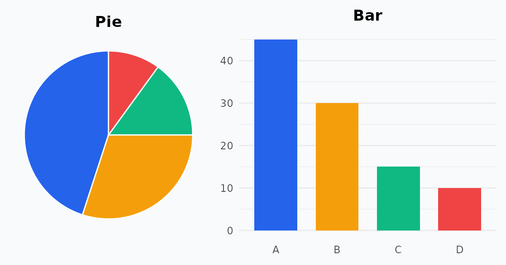

{fig-alt="A pie chart with four slices next to a bar chart of the same four values."}

Both charts show categories, but they answer different questions. A **pie chart** shows how a whole is divided. A **bar chart** compares values. Let's see when each one works, and how to draw them with `ggplot2`.

## When to Use a Pie Chart

Use a pie chart only when the categories are parts of a whole and add up to 100%.

**Best conditions**

- There are few categories, ideally five or fewer.
- We want to emphasise one dominant slice or a clear share, such as a half or a quarter.

**Examples**

- What percentage of total company revenue comes from each product line?
- What portion of the human body's mass consists of different chemical elements?

**Limitations**

- It is hard to read when slices are similar in size.
- It becomes cluttered with too many categories.

### A pie chart in ggplot2

`ggplot2` has no `geom_pie()`. A pie chart is a stacked bar drawn in polar coordinates: one bar of width 1, then `coord_polar("y")`.

```{r}
#| fig-width: 6
#| fig-height: 4.5
library(ggplot2)

revenue <- data.frame(
  product = c("Software", "Services", "Hardware", "Training"),
  share   = c(52, 28, 14, 6)
)

ggplot(revenue, aes(x = "", y = share, fill = product)) +
  geom_col(width = 1, colour = "white") +
  coord_polar(theta = "y") +
  geom_text(aes(label = paste0(share, "%")),
            position = position_stack(vjust = 0.5), colour = "white") +
  scale_fill_brewer(palette = "Dark2") +
  labs(title = "Share of revenue by product line", fill = NULL)
```

The pie works here: four categories, one clearly dominant, and the slices sum to 100%. Even so, labelling each slice with its percentage helps, because we judge angles poorly.

## When to Use a Bar Chart

Use a bar chart to compare values across categories or to follow change over time. It is the safer and clearer choice for almost all data sets.

**Best conditions**

- We are comparing quantities, counts, averages or independent numbers.
- There are many categories, or small differences that need precision.
- We are showing data over time, such as monthly sales or yearly growth.

**Examples**

- How many units did each store sell last month?
- How do the average test scores compare across ten classrooms?

**Advantage**

- Bars share a common baseline (the axis), so comparing lengths is easy and accurate.

### The same data as a bar chart

Here are the revenue shares again. Sorting the bars makes the ranking obvious.

```{r}
#| fig-width: 6
#| fig-height: 4
ggplot(revenue, aes(x = reorder(product, share), y = share)) +
  geom_col(fill = "steelblue") +
  geom_text(aes(label = paste0(share, "%")), hjust = -0.2) +
  coord_flip() +
  scale_y_continuous(limits = c(0, 60)) +
  labs(title = "Share of revenue by product line",
       x = NULL, y = "Share of revenue (%)")
```

### Where pies fail: similar slices

Suppose five regions have almost equal sales. We draw both charts side by side with the `patchwork` package (`install.packages("patchwork")`).

```{r}
#| fig-width: 8
#| fig-height: 3.8
library(patchwork)

regions <- data.frame(
  region = c("North", "South", "East", "West", "Central"),
  sales  = c(22, 21, 20, 19, 18)
)

pie <- ggplot(regions, aes(x = "", y = sales, fill = region)) +
  geom_col(width = 1, colour = "white") +
  coord_polar(theta = "y") +
  scale_fill_brewer(palette = "Set2") +
  labs(title = "Pie", fill = NULL)

bar <- ggplot(regions, aes(x = reorder(region, -sales), y = sales)) +
  geom_col(fill = "steelblue") +
  labs(title = "Bar", x = NULL, y = "Sales")

pie + bar
```

In the pie, which region is biggest? The slices look nearly identical. In the bar chart, the ranking is immediate.

### Many categories

With ten classrooms, a pie would be a mess of thin slices. A horizontal bar chart, sorted, stays readable and leaves room for long labels.

```{r}
#| fig-width: 6
#| fig-height: 4.5
scores <- data.frame(
  class = paste("Class", LETTERS[1:10]),
  mean  = c(71, 64, 78, 69, 82, 75, 60, 73, 67, 80)
)

ggplot(scores, aes(x = reorder(class, mean), y = mean)) +
  geom_col(fill = "darkorange") +
  coord_flip() +
  labs(title = "Average test score by classroom",
       x = NULL, y = "Average score")
```

### Change over time

A pie cannot show a trend. A bar (or line) chart can.

```{r}
#| fig-width: 7
#| fig-height: 4
sales <- data.frame(
  month = factor(month.abb, levels = month.abb),
  units = c(120, 135, 128, 150, 162, 158, 175, 181, 170, 190, 205, 230)
)

ggplot(sales, aes(x = month, y = units)) +
  geom_col(fill = "seagreen") +
  labs(title = "Units sold per month", x = NULL, y = "Units")
```

::: {.callout-tip}
Bar charts should start at zero. Truncating the axis exaggerates differences, because the reader compares bar lengths.
:::

## Quick Comparison

| Feature | Pie chart | Bar chart |
|---|---|---|
| Primary purpose | Part-to-whole relationships (percentages) | Comparing quantities and ranking categories |
| Data requirement | Must sum to 100% | Any numeric metric or count |
| Category limit | Best with 5 or fewer | Handles many categories easily |
| General rule | Use sparingly | When in doubt, use a bar chart |

## References

1. [How to choose between a pie chart and a bar chart](https://www.atlassian.com/data/charts/how-to-choose-pie-chart-vs-bar-chart), Atlassian
2. [Why pie charts are hard to read, and why bar charts are better](https://dreveal.com/why-pie-charts-are-hard-to-read-and-why-bar-charts-are-better/)
3. [Graphical displays for categorical data: bar charts and pie charts](https://stats.libretexts.org/Courses/Red_Rocks_Community_College/Introduction_to_Statistics_(RRCC)/03%3A_Visualizing_Data/3.01%3A_Graphical_Displays_for_Categorical_Data-_Bar_Charts_Pie_Charts), Statistics LibreTexts
