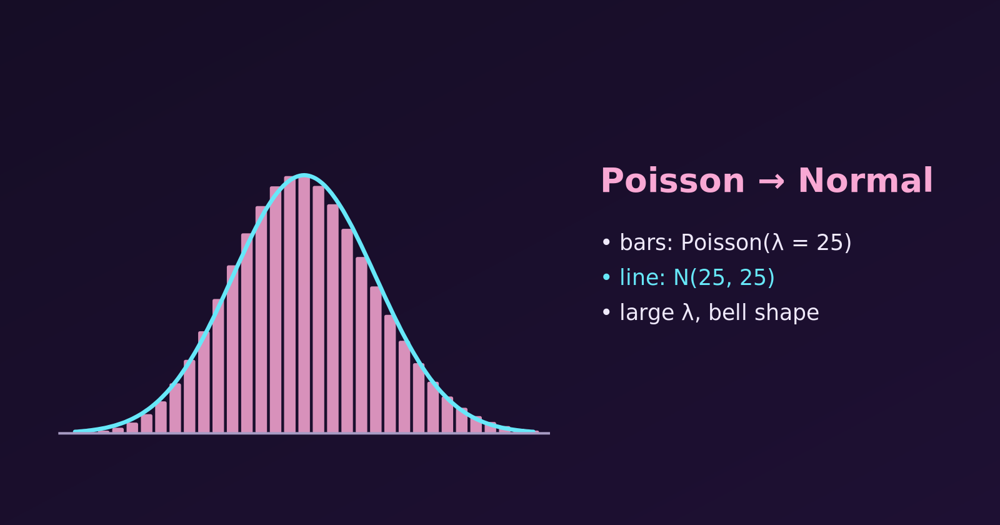

{.bk-adapt fig-alt="Pink bars of a Poisson distribution with mean 25 and a cyan normal curve drawn over them that follows the bar tops closely."}

A Poisson distribution $P(\lambda)$ can be approximated accurately by a normal distribution $N(\mu, \sigma^2)$ when the average rate $\lambda$ is large. For small $\lambda$ the Poisson is skewed to the right. As $\lambda$ grows, the skew fades and the distribution becomes a symmetric bell. Let's see when this works, how to use it, and how good it is. (For where the Poisson distribution comes from and what it is used for, see [Why Is the Poisson Distribution Used?](why-is-poisson-distribution-used.html))

## The Rule of Thumb

The approximation is reliable when:

- $\lambda \ge 10$ for a rough, quick approximation, and
- $\lambda \ge 20$ for good accuracy.

## Matching the Parameters

A Poisson variable has mean and variance both equal to $\lambda$. We give the normal distribution the same mean and variance:

- Mean: $\mu = \lambda$
- Variance: $\sigma^2 = \lambda$
- Standard deviation: $\sigma = \sqrt{\lambda}$

So, for large $\lambda$,

$$
X \sim P(\lambda) \quad \Longrightarrow \quad X \approx N(\lambda, \lambda).
$$

## The Continuity Correction

The Poisson counts whole numbers, but the normal distribution is continuous. To compensate, we move the boundary by $0.5$, so that each whole number $k$ is represented by the interval from $k - 0.5$ to $k + 0.5$.

| Poisson probability | Normal calculation |
|---|---|
| $P(X = k)$ | $P(k - 0.5 < X_{\text{normal}} < k + 0.5)$ |
| $P(X \le k)$ | $P(X_{\text{normal}} \le k + 0.5)$ |
| $P(X \ge k)$ | $P(X_{\text{normal}} \ge k - 0.5)$ |

## Example: Calls to a Call Centre

A call centre receives on average $\lambda = 25$ calls per hour. What is the probability of fewer than 20 calls in an hour?

### Exact Poisson answer

"Fewer than 20" means $X \le 19$:

$$
P(X \le 19) = \sum_{x=0}^{19} \frac{e^{-25} \, 25^x}{x!} \approx 0.1336.
$$

### Normal approximation

1. **Parameters:** $\mu = 25$ and $\sigma = \sqrt{25} = 5$.
2. **Continuity correction:** $X \le 19$ becomes $X_{\text{normal}} \le 19.5$.
3. **Z-score:**

$$
Z = \frac{19.5 - 25}{5} = \frac{-5.5}{5} = -1.1.
$$

4. **Table lookup:** $P(Z \le -1.1) \approx 0.1357$.

The approximation misses the exact value by only about $0.0021$.

### Checking in R

```{r}
# exact Poisson
ppois(19, lambda = 25)

# normal approximation, with continuity correction
pnorm(19.5, mean = 25, sd = 5)

# normal approximation, without the correction
pnorm(19, mean = 25, sd = 5)
```

Without the correction the answer is about $0.115$, which is much farther from the exact $0.1336$. The correction is worth the extra half unit.

## Watching the Poisson Become Normal

Let's plot the Poisson probabilities (bars) for three values of $\lambda$, with the normal curve $N(\lambda, \lambda)$ drawn over each.

```{r}
#| fig-width: 9
#| fig-height: 3.8
library(tidyverse)

lambdas <- c(2, 7, 25)

# show each panel only over the range where the probability is not negligible
xrange <- function(l) c(max(0, l - 4 * sqrt(l) - 2), l + 4 * sqrt(l) + 2)

plot_data <- map_dfr(lambdas, function(l) {
  r <- xrange(l)
  tibble(lambda = l, x = ceiling(r[1]):floor(r[2]), poisson = dpois(x, l))
}) %>%
  mutate(label = factor(paste("lambda =", lambda), levels = paste("lambda =", lambdas)))

curve_data <- map_dfr(lambdas, function(l) {
  tibble(lambda = l, x = seq(xrange(l)[1], xrange(l)[2], length.out = 400),
         normal = dnorm(x, l, sqrt(l)))
}) %>%
  mutate(label = factor(paste("lambda =", lambda), levels = paste("lambda =", lambdas)))

ggplot() +
  geom_col(data = plot_data, aes(x, poisson), fill = "steelblue", alpha = 0.8) +
  geom_line(data = curve_data, aes(x, normal), colour = "tomato", linewidth = 1) +
  facet_wrap(~ label, scales = "free_x") +
  labs(title = "Poisson (bars) and the normal curve N(λ, λ) (line)",
       x = "Number of events", y = "Probability")
```

What to look for:

- **$\lambda = 2$:** the peak is pressed against zero and the right tail is long. The normal curve even gives some probability to negative values, so it is a poor fit.
- **$\lambda = 7$:** the peak has moved away from zero and rounded off, but a slight skew to the right remains.
- **$\lambda = 25$:** the bars are centred and smooth, and the curve follows them closely.

## How Good Is the Approximation?

One way to measure the error is the largest gap between the exact and approximate cumulative probabilities. We compare the normal approximation with and without the continuity correction.

```{r}
max_error <- function(l, correction) {
  x <- 0:(3 * l + 10)
  shift <- if (correction) 0.5 else 0
  max(abs(ppois(x, l) - pnorm(x + shift, l, sqrt(l))))
}

tibble(lambda = c(2, 5, 10, 20, 25, 50)) %>%
  mutate(with_correction    = map_dbl(lambda, max_error, correction = TRUE),
         without_correction = map_dbl(lambda, max_error, correction = FALSE)) %>%
  mutate(across(-lambda, ~ round(.x, 4))) %>%
  knitr::kable()
```

Two things stand out. The error shrinks as $\lambda$ grows, and it is always much smaller with the continuity correction. At $\lambda = 20$ the largest error with the correction is about $0.015$, which supports the rule of thumb of $\lambda \ge 20$.

::: {.callout-tip}
For a single probability, check the exact value with `ppois()` or `dpois()` when software is available. The normal approximation is mainly useful for hand calculation, and for seeing why the bell shape appears.
:::

## Summary

- Use $P(\lambda) \approx N(\lambda, \lambda)$ when $\lambda$ is large, say $\lambda \ge 20$ (a rough check is $\lambda \ge 10$).
- Always apply the continuity correction of $\pm 0.5$.
- The approximation improves steadily as $\lambda$ grows.

Related: [Why Is the Poisson Distribution Used?](why-is-poisson-distribution-used.html) covers real-world uses of the Poisson distribution and the conditions under which it fits.
