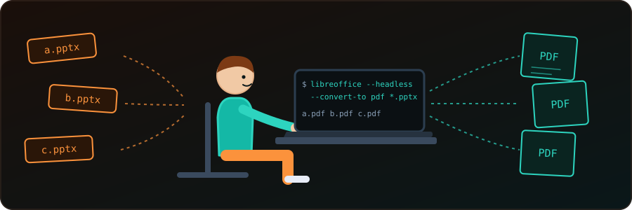

{fig-alt="A sketch of a person at a laptop running libreoffice --headless --convert-to pdf; three PPTX files on the left become three PDF pages on the right."}

Opening each presentation and choosing *Export as PDF* is fine for one file and painful for fifty. The terminal can do it for us. The simplest tool is LibreOffice running without a window; the rest of this post covers a few alternatives.

## LibreOffice (Linux, macOS, Windows)

LibreOffice is installed on many Linux distributions already, and its `--headless` mode converts files without opening the GUI.

Convert a single file:

```bash
libreoffice --headless --convert-to pdf presentation.pptx
```

Convert every `.pptx` in the current folder:

```bash
libreoffice --headless --convert-to pdf *.pptx
```

The PDFs are written to the current directory. To put them somewhere else, add `--outdir`:

```bash
libreoffice --headless --convert-to pdf --outdir pdf/ *.pptx
```

Old `.ppt` files work the same way; use `*.ppt` instead.

### A whole folder tree

The glob `*.pptx` only sees one folder. To convert files in sub-folders too, let `find` feed them in, keeping each PDF next to its source:

```bash
find . -type f \( -iname '*.pptx' -o -iname '*.ppt' \) -print0 |
  while IFS= read -r -d '' f; do
    libreoffice --headless --convert-to pdf --outdir "$(dirname "$f")" "$f"
  done
```

`-print0` with `read -d ''` keeps file names that contain spaces intact.

::: {.callout-note}
If LibreOffice is already open in the GUI, a headless run may do nothing. Close the window first. On macOS the executable is usually `/Applications/LibreOffice.app/Contents/MacOS/soffice`, and on Linux `soffice` is the same program as `libreoffice`.
:::

## unoconv (Linux)

`unoconv` is a command-line wrapper around LibreOffice.

```bash
sudo apt-get install unoconv
unoconv -f pdf presentation.ppt
```

It needs LibreOffice installed too, so for a plain conversion the direct command above is simpler.

## Win2PDF (Windows)

On Windows with Win2PDF Pro, the `win2pdfd.exe` utility converts from the command line:

```cmd
win2pdfd.exe ppt2pdf "source.ppt" "dest.pdf"
win2pdfd.exe pptx2pdf "source.pptx" "dest.pdf"
```

This is a commercial product; see the Win2PDF documentation for the details.

## ONLYOFFICE Document Builder

Unlike LibreOffice, ONLYOFFICE has no single conversion flag. Its Document Builder (Windows, Linux, macOS) runs a small JavaScript file. Save this as `convert.js`:

```javascript
builder.OpenFile("presentation.pptx");
builder.SaveFile("pdf", "presentation.pdf");
builder.CloseFile();
```

and run it:

```bash
documentbuilder convert.js      # Linux and macOS
docbuilder.exe convert.js       # Windows
```

There is no built-in recursive mode. To convert a folder tree, wrap the call in a Bash or PowerShell loop that generates the script (or passes the paths) for each file. If we run a self-hosted ONLYOFFICE Document Server, its Conversion API can do the same job through an HTTP POST with `curl`.

## Which one to use

| Need | Tool |
|---|---|
| One file or one folder | `libreoffice --headless --convert-to pdf` |
| Many folders | the `find` loop above |
| Windows with Win2PDF Pro | `win2pdfd.exe` |
| Already using ONLYOFFICE | Document Builder or the Conversion API |

For most of us, headless LibreOffice is enough: one command, no scripting. Check a converted PDF or two, since fonts missing on the machine are replaced and can change the layout.

## References

- [Ask Ubuntu: How can I convert a PPT to a PDF from the command line?](https://askubuntu.com/questions/11130/how-can-i-convert-a-ppt-to-a-pdf-from-the-command-line)
- [Win2PDF: command-line PPT to PDF](https://www.win2pdf.com/doc/command-line-ppt-to-pdf.html) and [PPTX to PDF](https://www.win2pdf.com/doc/command-line-pptx-to-pdf.html)
- [ONLYOFFICE Document Builder: using the CLI](https://api.onlyoffice.com/docs/document-builder/using-cli/overview)
