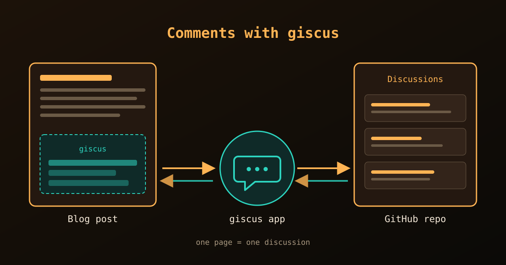

{fig-alt="A blog post page contains a giscus comment box. The giscus app passes comments to and from a list of discussions in a GitHub repository."}

[giscus](https://giscus.app) is an open-source, ad-free comment system that stores every comment as a **GitHub Discussion**. Readers sign in with GitHub, and we get moderation, notifications and email replies without running a server. Quarto supports giscus natively, so the whole setup is a few GitHub settings plus one block of YAML.

## Step 1: Prepare the GitHub repository

The comments live in a repository, so we prepare it first.

1. **Make the repository public.** giscus does not work with a private repository.
2. **Enable Discussions.** On the repository page, open *Settings*, scroll to *Features* and tick **Discussions**.
3. **Install the giscus app.** Open the [giscus app page](https://github.com/apps/giscus), click *Install*, and give it access to the chosen repository.
4. **Get the IDs.** On [giscus.app](https://giscus.app), type `username/repo-name` in the *Repository* box and choose a discussion *Category* (for example `General`). Keep the page open: further down it prints a `<script>` block with the values `data-repo-id` and `data-category-id`. We need both in the next step.

::: {.callout-tip}
Choose the category **General** (or a dedicated one) rather than *Announcements*. Announcements is meant for posts from maintainers, so it can limit who may start a discussion.
:::

## Step 2: Add the configuration

giscus gives us HTML, but Quarto writes the script tag for us. We only translate each `data-*` attribute into a YAML key: `data-repo-id` becomes `repo-id`, `data-category-id` becomes `category-id`, and so on.

The block goes under the `website:` key in `_quarto.yml` when we want comments on **every** page:

```yaml
website:
  comments:
    giscus:
      repo: username/repo-name
      repo-id: "R_kgDOxxxxxxx"          # from giscus.app
      category: "General"
      category-id: "DIC_kwDOxxxxxxx"    # from giscus.app
      mapping: pathname                 # how a page is matched to a discussion
      reactions-enabled: true           # emoji reactions
      input-position: bottom            # comment box below the comments
      loading: lazy                     # load only when scrolled into view
```

The `mapping` option decides how a page finds its discussion. `pathname` and `url` are the common choices: each page gets one discussion, created the first time someone comments.

::: {.callout-warning}
Changing `mapping` later, or moving a post to a new address, starts a new, empty discussion for it. Choose once and keep the URLs stable.
:::

## Step 3: Comments on posts only

A blog usually wants comments under the posts, but not on the *About* page or the homepage. For that, keep the block **out** of `_quarto.yml` and put it in `posts/_metadata.yml` instead. Every file in that folder inherits it.

In a `_metadata.yml` file the options are top-level keys, so there is no `website:` line:

```yaml
# posts/_metadata.yml
comments:
  giscus:
    repo: username/repo-name
    repo-id: "R_kgDOxxxxxxx"
    category: "General"
    category-id: "DIC_kwDOxxxxxxx"
    mapping: url
    reactions-enabled: true
    input-position: bottom
    language: en
```

Then render. A single post is enough to test it:

```bash
quarto render posts/my-post.qmd
```

Posts that were rendered earlier only get the comment box when they are rendered again, so after the first setup it is worth running a full `quarto render`.

## Hiding comments on one page

Even inside the folder, a single page can opt out through its front matter:

```yaml
---
title: "A post without comments"
comments: false
---
```

## Theme

If the site has a light and a dark theme, we can leave `theme` out. Quarto then follows the reader's choice from the theme toggle. To force one look instead, set `theme: light`, `theme: dark` or `theme: preferred_color_scheme` (follow the operating system) under `giscus:`.

## Troubleshooting

- **The box says "giscus is not installed on this repository":** install the app (step 1.3) for that exact repository.
- **No box appears at all:** check that the block sits in the right file (`website:` for `_quarto.yml`, top level for `_metadata.yml`) and that the page was re-rendered.
- **"Discussion not found" appears and never changes:** the discussion is only created when the first comment is posted, so this is normal for a new page.

## Reference

- [Quarto: website comments](https://quarto.org/docs/reference/projects/websites.html#comments), for every option of the `comments` key.
- [giscus.app](https://giscus.app), for the configuration page that generates the IDs.
