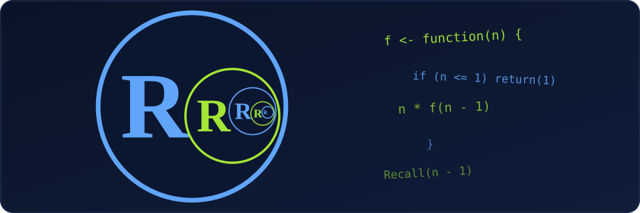

R, like C and Python, supports **recursion**: a function can call itself, directly or through another function. Every recursive function needs two parts:

- a **base case** that returns an answer without calling itself, so the process stops;
- a **recursive case** that calls the function again on a smaller problem.

{fig-alt="A large circle with the letter R holds a half-size circle with an R, which holds another smaller circle again, shrinking to the right. Lines of R code for a recursive function float beside it."}

## A basic example

```r
factorial_rec <- function(n) {
  if (n <= 1) return(1)        # base case
  n * factorial_rec(n - 1)     # recursive case
}

factorial_rec(5)
```

```
[1] 120
```

The call for 5 waits for the call for 4, which waits for the call for 3, and so on. At `n = 1` the base case answers, and the results multiply on the way back.

## Indirect recursion

Two functions can call each other. Here `is_even()` and `is_odd()` take turns until `n` reaches 0:

```r
is_even <- function(n) {
  if (n == 0) return(TRUE)
  is_odd(n - 1)
}

is_odd <- function(n) {
  if (n == 0) return(FALSE)
  is_even(n - 1)
}

is_even(10)
```

```
[1] TRUE
```

## `Recall()`: recursion without the function's name

`Recall()` calls the function that is currently running. It helps for anonymous functions, or when we rename a function later and do not want to edit the body:

```r
fib <- function(n) {
  if (n <= 1) return(n)
  Recall(n - 1) + Recall(n - 2)
}

fib(10)
```

```
[1] 55
```

## Recursion on nested lists

Lists can hold other lists, and recursion follows that shape naturally. This function counts how deeply a list is nested:

```r
depth <- function(x) {
  if (!is.list(x)) return(0)           # not a list: depth 0
  if (length(x) == 0) return(1)        # empty list: avoid max() of nothing
  1 + max(vapply(x, depth, numeric(1)))
}

depth(list(1, list(2, list(3))))
```

```
[1] 3
```

The outer list, the list holding `2`, and the list holding `3` make three levels. Without the empty-list check, `depth(list())` would warn and return `-Inf`, because `max()` of nothing has no answer.

## Limits in R

::: {.callout-warning}
R does **not** optimise tail calls, so every call stays on the stack until the whole chain finishes. Deep recursion can fail.
:::

Let's count down from `n` with a recursive function and see how deep we can go on a default R session:

```r
f <- function(n) if (n == 0) 0 else 1 + f(n - 1)

f(1000)
f(5000)
```

```
[1] 1000
Error: evaluation nested too deeply: infinite recursion / options(expressions=)?
```

Three limits matter.

### The `expressions` limit

R caps how deeply expressions nest. The default is 5000, and we can raise it (up to 500000):

```r
options(expressions = 50000)
f(5000)
```

```
[1] 5000
```

### The stack limit

Raising `expressions` only moves the wall. On our machine, `f(20000)` then fails with `node stack overflow`. A different error, `C stack usage is too close to the limit`, can also appear. Both come from fixed memory limits, and the exact depth depends on the system.

### Speed

Function calls cost more than loop steps. Naive `fib(25)` took roughly 0.1 to 0.2 seconds here, and each extra step makes it about 1.6 times slower, because the same values are computed again and again.

## Memoisation

Caching results fixes the repeated work. The `memoise` package (install it with `install.packages("memoise")`) wraps a function so each answer is computed once:

```r
library(memoise)

fib_fast <- memoise(function(n) {
  if (n <= 1) return(n)
  fib_fast(n - 1) + fib_fast(n - 2)
})

fib_fast(40)
```

```
[1] 102334155
```

Without the cache, the same call would repeat hundreds of millions of steps.

## When a loop is better

For simple repeated work, a loop is faster and has no depth limit:

```r
fib_loop <- function(n) {
  a <- 0
  b <- 1
  for (i in seq_len(n)) {
    next_value <- a + b
    a <- b
    b <- next_value
  }
  a
}

fib_loop(40)
```

```
[1] 102334155
```

`Reduce()` is another option for folds, for example `Reduce("*", 1:5)` gives `120`, the same as `factorial_rec(5)`.

## When recursion fits

Recursion is a good choice when the problem is naturally recursive:

- walking nested lists or JSON-like data;
- working with trees (for example from `rpart` or `data.tree`);
- going through R's own code (language objects);
- divide-and-conquer methods such as merge sort and quicksort.

Rule of thumb: use recursion when it makes the code **clearer**. Switch to a loop when the depth may pass about 1000, when speed matters, or when we hit the `expressions` or stack limits above.
