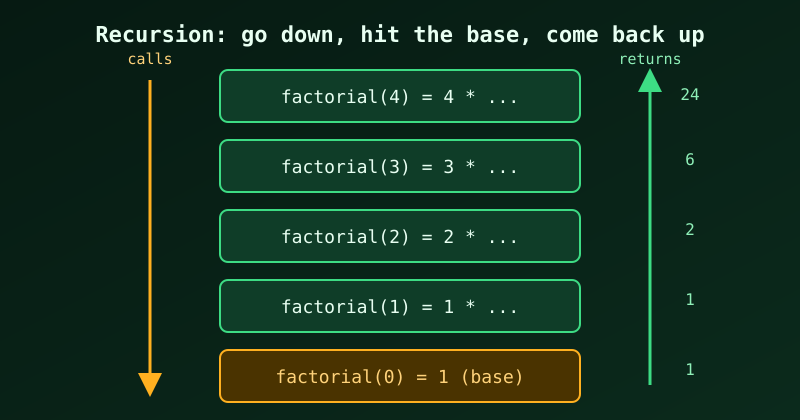

{fig-alt="Stack of boxes from factorial(4) down to factorial(0), with an arrow down for calls and an arrow up for returned values 1, 1, 2, 6, 24."}

Recursion means a function solves a problem by calling itself on a smaller version of that problem. Let's look at a simple example, `sum(n)`, the sum of the first `n` integers, and trace `sum(3)` step by step:

```
GOING DOWN                              RETURNING UP
sum(3) = 3 + sum(2)              ──┐
sum(2) = 2 + sum(1)              ──┤    sum(0) = 0                (base hit)
sum(1) = 1 + sum(0)              ──┤    sum(1) = 1 + 0 = 1
sum(0) = 0   ← base              ──┘    sum(2) = 2 + 1 = 3
                                        sum(3) = 3 + 3 = 6
```

Each call waits for the one below it, and the additions can only happen on the way **back up**, once `sum(0)` has returned.

This is a textbook recursion example. It has the three things every recursive function needs:

1. **A base case that stops the recursion** — `sum(0) = 0`. Without this, it would call `sum(-1)`, `sum(-2)`, … forever (stack overflow).
2. **A recursive case that shrinks the problem** — `sum(3)` calls `sum(2)`, which calls `sum(1)`… each call gets *closer* to the base case.
3. **The "unwinding"** — once `sum(0)` returns `0`, the answers flow back up: `1+0=1`, `2+1=3`, `3+3=6`.

That "go down, hit bottom, come back up" shape is the heart of all simple recursion. In C, `sum` looks like this:

```c
#include <stdio.h>

int sum(int n) {
    if (n == 0) return 0;     // BASE CASE
    return n + sum(n - 1);    // RECURSIVE CASE
}

int main(void) {
    printf("%d\n", sum(3));   // 6
    return 0;
}
```

---

## Another example: factorial, with full step trace

`factorial(n) = n × (n-1) × … × 1`, and `factorial(0) = 1` by definition (the base case).

```c
#include <stdio.h>

long factorial(int n) {
    if (n == 0) {          // BASE CASE: stop here
        return 1;
    }
    return n * factorial(n - 1);   // RECURSIVE CASE: shrink n
}

int main(void) {
    for (int i = 0; i <= 5; i++)
        printf("%d! = %ld\n", i, factorial(i));
    return 0;
}
```

Compile and run (`gcc factorial.c -o factorial && ./factorial`; see [Compiling and Running C Programs on Linux](running-c-programs-on-linux.qmd) for faster workflows):

```
0! = 1
1! = 1
2! = 2
3! = 6
4! = 24
5! = 120
```

### Step-by-step trace of `factorial(4)`

```
GOING DOWN                              RETURNING UP
factorial(4) = 4 * factorial(3)  ──┐
factorial(3) = 3 * factorial(2)  ──┤    factorial(0) = 1          (base hit)
factorial(2) = 2 * factorial(1)  ──┤    factorial(1) = 1 * 1 = 1
factorial(1) = 1 * factorial(0)  ──┤    factorial(2) = 2 * 1 = 2
factorial(0) = 1   ← base        ──┘    factorial(3) = 3 * 2 = 6
                                        factorial(4) = 4 * 6 = 24
```

Notice the multiplication can't happen until the call *below* returns ; that's why the result is computed on the way **back up**, not on the way down. This is the same shape as the `sum` example.

### Same skeleton, side by side

| | `sum(n)` | `factorial(n)` |
|---|---|---|
| Base case | `n == 0 → 0` | `n == 0 → 1` |
| Recursive case | `n + sum(n-1)` | `n * factorial(n-1)` |
| How it shrinks | `n → n-1` | `n → n-1` |
| Combines results by | `+` | `*` |

The only real difference is **what operator you apply when coming back up**. Recursion's structure is remarkably reusable — change the base value and the operator, and you get a whole family of functions.

---

## A second example where recursion *branches*: power

Simple linear recursion calls itself **once** per step (like `sum` and `factorial`). A more interesting form calls itself and combines — here, `power` computes `x^n` fast by halving `n`:

```c
#include <stdio.h>

double power(double x, int n) {
    if (n == 0) return 1.0;                 // BASE: x^0 = 1
    if (n < 0)  return 1.0 / power(x, -n);  // handle negatives
    if (n % 2 == 0) {                       // even n: x^n = (x^(n/2))^2
        double half = power(x, n / 2);
        return half * half;
    }
    return x * power(x, n - 1);             // odd n: peel one off
}

int main(void) {
    printf("%.0f\n", power(2, 10));   // 1024
    printf("%.0f\n", power(3, 4));    // 81
    return 0;
}
```

Trace of `power(2, 10)`:

```
power(2,10) → half = power(2,5); return half*half
  power(2,5) → return 2 * power(2,4)
    power(2,4) → half = power(2,2); return half*half
      power(2,2) → half = power(2,1); return half*half
        power(2,1) → return 2 * power(2,0)
          power(2,0) → 1                       (base)
        power(2,1) → 2 * 1 = 2
      power(2,2) → 2 * 2 = 4
    power(2,4) → 4 * 4 = 16
  power(2,5) → 2 * 16 = 32
power(2,10) → 32 * 32 = 1024
```

This does only ~5 multiplications instead of 10 — the halving is why fast exponentiation is O(log n). Recursion isn't just elegant; it can be *algorithmically* better.

---

## How to tell a good recursion example

A good teaching example should:

- Have an **obvious base case** you can state in one line (`sum(0)=0`, `0!=1`, `x^0=1`).
- **Shrink** toward the base on every call (`n → n-1`, `n → n/2`).
- Be **naturally self-similar** — the problem really is "a smaller copy of itself."
- Show the **returning-up** phase clearly (the `sum` trace does this well).

The `sum` example hits all four, so it is a good one to teach first.

## The pitfalls to mention alongside it

| Pitfall | Symptom |
|---|---|
| **No base case**, or one never reached | Infinite recursion → stack overflow / segfault |
| **Wrong base value** | Off-by-one results (e.g. `sum` base `1` instead of `0`) |
| **Not shrinking** (e.g. calls `sum(n)` again) | Infinite recursion |
| **Deep recursion** (n = 1,000,000) | Stack overflow even when logically correct |
| **Redundant recomputation** (naive Fibonacci) | Exponential blowup — `fib(40)` takes seconds |

### The one-line rule

> **Recursion = base case + smaller subproblem + combine on the way back up.** If you can write those three lines, you've written the function.

The `sum` example has all three parts, which makes it a good first example. `factorial` is the natural next one because it's the same skeleton with a different operator, and `power` shows that recursion can also *branch* and be faster than a loop.

::: {.callout-tip}
The same ideas carry over to other languages. See [Recursion in R: Functions That Call Themselves](r-recursion.qmd) for base and recursive cases, `Recall()`, recursion on nested lists and R's depth limits.
:::
