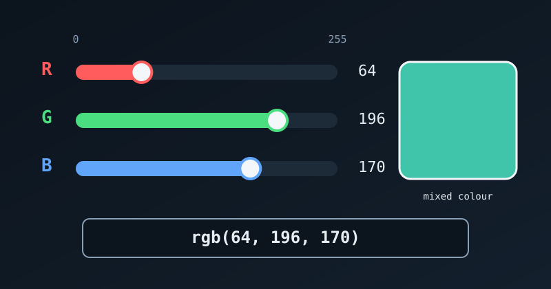

{fig-alt="Three sliders set red to 64, green to 196 and blue to 170, mixing into a teal swatch labelled rgb(64, 196, 170)."}

An **RGB color code** tells a digital screen exactly how much red, green and blue light to mix to make a colour. A [hex code](hex-color-code-explained.qmd) writes the same three amounts in base 16. An RGB code writes them as ordinary decimal numbers from 0 to 255.

## The Anatomy of an RGB Code

An RGB code is written like a function with three numbers in parentheses:

```default
rgb(Red, Green, Blue)
```

- `0` means the channel is completely off (no light).
- `255` means the channel is at full intensity.

Screens create colour by **adding light** (the additive colour model), and three channels with 256 levels each give 256 × 256 × 256 = 16,777,216 possible colours.

## RGB vs Hex

An RGB code uses the same numbers we get when converting each pair of a hex code. Here are the basic colours in both forms:

| Colour | Hex | RGB | Why |
|---|---|---|---|
| Pure red | `#FF0000` | `rgb(255, 0, 0)` | Full red, no green, no blue |
| Pure green | `#00FF00` | `rgb(0, 255, 0)` | No red, full green, no blue |
| Pure blue | `#0000FF` | `rgb(0, 0, 255)` | No red, no green, full blue |
| Black | `#000000` | `rgb(0, 0, 0)` | All lights off |
| White | `#FFFFFF` | `rgb(255, 255, 255)` | All lights at full intensity |

In the hex post we worked out that the pair `A3` equals 10 × 16 + 3 = 163. So the hex code `#A30000` is the same colour as `rgb(163, 0, 0)`.

### Converting in R

R can move between the two forms. `col2rgb()` turns a hex code into RGB numbers:

```r
col2rgb("#40C4AA")
```

```default
      [,1]
red     64
green  196
blue   170
```

and `rgb()` turns RGB numbers into a hex code:

```r
rgb(64, 196, 170, maxColorValue = 255)
```

```default
[1] "#40C4AA"
```

## What Is RGBA?

Sometimes a fourth number is added: `rgba(Red, Green, Blue, Alpha)`. The **alpha** channel sets transparency, on a scale from 0.0 to 1.0:

- `0.0`: completely invisible
- `0.5`: half see-through
- `1.0`: completely solid

For example, this gives a vibrant blue that lets whatever is behind it show through:

```default
rgba(0, 0, 255, 0.5)
```

In hex, alpha becomes an extra pair at the end. In R, `rgb()` takes an `alpha` argument on a 0 to 1 scale and reproduces it:

```r
rgb(0, 0, 1, alpha = 0.5)
```

```default
[1] "#0000FF80"
```

The `80` is 0.5 × 255 rounded to 128, which is `80` in hex.

## See Also

- [Hex Color Codes Explained](hex-color-code-explained.qmd): the base-16 form and how to convert a pair by hand.
