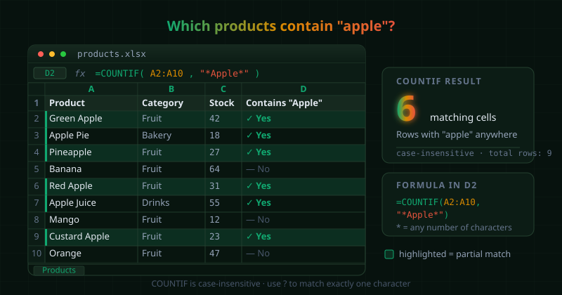

{fig-alt="Excel worksheet with Product, Category, and Stock columns. Rows containing the substring apple, including Green Apple, Apple Pie, Pineapple, Red Apple, Apple Juice, and Custard Apple, are highlighted, and COUNTIF in D2 returns 6 matching cells."}

Sometimes we need to count cells that contain only *part* of a text, such as every product with "Apple" in its name. An exact `COUNTIF` can't do that, but wildcards can. To count cells that contain a substring **anywhere** inside them, we put the asterisk (`*`) on both sides of the search text:

```default
=COUNTIF(range, "*substring*")
```

For example, this formula counts every cell in `A2:A10` that has "Apple" anywhere in its text (case-insensitive), so "Green Apple", "Pineapple" and "Apple Pie" all count:

```default
=COUNTIF(A2:A10, "*Apple*")
```

---

## Using a Cell Reference as the Search Term

If the search text lives in another cell (say `B2`), we can't just type `*B2*`, because Excel would treat that as literal characters. Instead, we **concatenate** the wildcards around the cell reference with the `&` operator:

```default
=COUNTIF(A2:A10, "*" & B2 & "*")
```

This builds the pattern `"*Apple*"` at runtime from whatever is in `B2`, so changing `B2` updates the count instantly.

---

## Other Wildcard Patterns

Two wildcards do all the work:

- `*` matches any number of characters (including none)
- `?` matches exactly one character

Here is how we combine them:

**Starts with** a text:

```default
=COUNTIF(A2:A10, "Apple*")
```

**Ends with** a text:

```default
=COUNTIF(A2:A10, "*Apple")
```

**One unknown character**, e.g. matches "Jan" and "Jun":

```default
=COUNTIF(A2:A10, "J?n")
```

---

## The Same Three Patterns with a Reference Cell

Suppose the search term is in `A3` and the data sits in `F9:F100`. The row is locked with `$` so the range stays put when we drag the formula down.

**Contains** (anywhere):

```default
=COUNTIF(F$9:F$100, "*" & A3 & "*")
```

**Starts with:**

```default
=COUNTIF(F$9:F$100, A3 & "*")
```

**Ends with:**

```default
=COUNTIF(F$9:F$100, "*" & A3)
```

::: {.callout-note}
In Google Sheets an open-ended range such as `F$9:F` also works. Excel needs an explicit end row (or a whole column like `F:F`).
:::

---

::: {.callout-tip}
### Handle Empty Search Cells Safely

If `A3` is blank, `"*" & A3 & "*"` becomes `"**"`, which matches **every** text cell in the range. We can wrap the formula in an `IF` so it returns `0` when the criteria cell is empty:

```default
=IF(A3="", 0, COUNTIF(F$9:F$100, "*" & A3 & "*"))
```

Testing `A3=""` is safer than `ISBLANK(A3)`, because it also catches cells that hold an empty string returned by another formula.
:::

---

## Searching for a Literal `*` or `?`

Since `*` and `?` are wildcards, searching for them as ordinary characters needs a tilde (`~`) in front. This counts cells containing a real question mark:

```default
=COUNTIF(A2:A10, "*~?*")
```

---

## Quick Reference

- `COUNTIF` is **case-insensitive**
- Wildcards only match **text**; numbers stored as numbers are not counted by `"*5*"`
- Use `$` to lock the range (`F$9:F$100`) when dragging the formula down
- For several conditions at once, use `COUNTIFS` with the same wildcard logic

---

## Further Reading

- [Microsoft: COUNTIF function](https://support.microsoft.com/en-us/office/countif-function-e0de10c6-f885-4e71-abb4-1f464816df34)
- [Ablebits: COUNTIF with partial match](https://www.ablebits.com/office-addins-blog/excel-count-cells-with-specific-text/)
