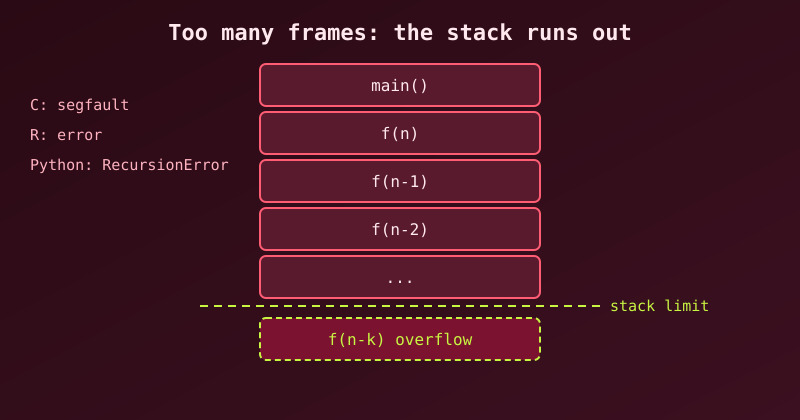

{fig-alt="A column of stack frames growing downward past a dashed stack-limit line, with notes for C, R and Python."}

This post follows [Recursion in C](recursion-with-c-examples.qmd) and [Recursion in R](r-recursion.qmd): what happens when recursion goes too deep, and what to do about it.

## What a stack overflow actually is

Every function call pushes a **stack frame** onto the **call stack**, a block of memory holding that call's parameters, local variables, and return address. The stack is a **fixed-size region** decided when the program starts (typically **8 MB** for the main thread on Linux and **1 MB** on Windows).

```
   high address
   ┌──────────────┐
   │  frame main  │
   ├──────────────┤
   │  frame f(3)  │  ← each recursive call pushes another frame
   ├──────────────┤
   │  frame f(2)  │
   ├──────────────┤
   │  frame f(1)  │
   ├──────────────┤
   │     ...      │  ← keep pushing → grow downward
   └──────────────┘
   low address         ← the stack limit is here
```

When frames keep piling up past that limit, the program **writes off the end of the stack**: a **stack overflow**. What happens next depends on the language's runtime:

| Language | On overflow | Catchable? |
|---|---|---|
| **C** | Segfault (SIGSEGV) — process dies | ❌ No |
| **R** | `Error: evaluation nested too deeply` (or `node stack overflow` when `expressions` is raised) | ✅ Yes (an R error) |
| **R** (C stack exhausted) | `Error: C stack usage … is too close to the limit`, can crash | ⚠️ Sometimes |
| **Python** | `RecursionError` | ✅ Yes (a Python exception) |

The **cause is always one of two things**:
1. **No base case**, or a base case never reached → infinite recursion.
2. **A correct but very deep recursion** (depth ~10⁵–10⁶) → legitimate algorithm, too many frames.

---

## C: dies with a segfault

### Infinite recursion (no base case)

```c
#include <stdio.h>

int sum(int n) {
    return n + sum(n - 1);   // ❌ never stops
}

int main(void) {
    printf("%d\n", sum(3));
    return 0;
}
```
```
$ gcc so1.c -o so1 && ./so1
Segmentation fault (core dumped)
```
Each call pushes a frame; after a few hundred thousand frames (depending on frame size and stack limit), the stack runs out and the CPU faults on the write. There is **no error message and no recovery**; the process is just gone.

::: {.callout-warning}
With optimisation the result can differ. Compiled with `gcc -O2`, this same program did **not** crash on our machine: it ran forever, because the compiler turned the tail call into a loop. A runaway recursion is a bug either way, but do not count on a segfault to reveal it.
:::

### A "correct" recursion that's still too deep

```c
int sum_to(int n) {
    if (n == 0) return 0;          // ✅ proper base case
    return n + sum_to(n - 1);
}
// sum_to(10000000);  → segfault at -O0
```
The base case is fine, but **depth = n** frames. At 10⁷ calls × a few dozen bytes per frame, that is hundreds of MB of stack, far past the 8 MB limit. We compiled it with plain `gcc` and it segfaulted.

::: {.callout-note}
With `gcc -O2` the same program ran without crashing, because GCC rewrote the recursion as a loop. (It printed `-2004260032`, since the true sum overflows `int`; use `long` for real work.) The C standard does not promise this optimisation, so the code is still unsafe.
:::

### The sneakier version: huge local arrays

```c
void recurse(int n) {
    int buffer[100000];            // ~400 KB per frame!
    recurse(n + 1);
}
```
About **20 calls** are enough to fill an 8 MB stack, because each frame carries a 400 KB local array. This is why frame size matters as much as depth. (We ran a version that recurses 1000 levels; it segfaulted.)

**Inspect your limits:**
```bash
ulimit -s              # stack size in KB (e.g. 8192 = 8 MB)
gcc -fstack-usage ...  # per-function frame sizes in a .su file
```

---

## R: usually an R error, sometimes a C-stack crash

### Infinite recursion → R's `expressions` limit

```r
f <- function(n) n + f(n - 1)
f(1)
```
```
Error: evaluation nested too deeply: infinite recursion / options(expressions=)?
```
R doesn't let nesting run away silently: it counts nested expressions and stops at `options(expressions)`, which defaults to **5000**. This is a **catchable R error** (you can wrap it in `tryCatch`), not a process crash.

### A legitimate deep recursion that still fails

```r
sum_to <- function(n) if (n == 0) 0 else n + sum_to(n - 1)

sum_to(100)     # fine
sum_to(10000)   # Error: evaluation nested too deeply
```

You can raise the limit:
```r
options(expressions = 100000)
sum_to(10000)    # works
sum_to(100000)   # Error: node stack overflow
```
R 4.6 stopped the second call with `node stack overflow`, R's own evaluation stack. Other builds, or functions with larger frames, can instead hit the **C stack** and report:
```
Error: C stack usage  7970000 is too close to the limit
```
That is the *actual* OS stack filling, closer to C's situation. Raising `expressions` does not grow the stack; it only moves the point where R complains.

**Inspect it:**
```r
getOption("expressions")   # 5000 by default
options(expressions = 20000)
```

---

## Python: a clean, catchable `RecursionError`

### Infinite recursion

```python
def sum_to(n):
    return n + sum_to(n - 1)     # no base case

sum_to(3)
```
```
RecursionError: maximum recursion depth exceeded
```
Python counts **Python frames** and stops at `sys.getrecursionlimit()` — default **1000**. Unlike C, this is a normal exception you can catch:
```python
try:
    sum_to(3)
except RecursionError:
    print("too deep!")
```

### The trap: raising the limit can segfault

```python
import sys
sys.setrecursionlimit(1000000)   # ⚠️ dangerous
sum_to(1000000)                  # segfault, not RecursionError
```
`setrecursionlimit` only raises **Python's counter**. The **C stack** behind it is still ~8 MB. If CPython's own C-level recursion runs out before the Python counter trips, you get a **hard segfault**, with no exception and no message. On Python 3.10 this exact example dumped core on our machine. (Recent CPython versions add C-stack guards that convert some of these to `RecursionError`, but it is not safe to rely on.)

### A correct deep recursion that still fails

```python
def sum_to(n):
    if n == 0:
        return 0
    return n + sum_to(n - 1)

sum_to(100)     # ✅ 5050
sum_to(10000)   # ❌ RecursionError: maximum recursion depth exceeded in comparison
```

---

## How to avoid it, in any language

### 1. Always have a reachable base case that shrinks the problem
```c
int sum(int n) {
    if (n == 0) return 0;   // base case
    return n + sum(n - 1);  // shrinks toward base
}
```
If the argument doesn't move toward the base on every call, it's infinite.

### 2. Convert linear recursion to a loop (the best fix when you can)

This is the real solution for `sum`, `factorial`, and any "n → n−1" chain. Depth O(n) becomes depth O(1):

```c
// C
long sum_to(int n) {
    long s = 0;
    for (int i = 1; i <= n; i++) s += i;
    return s;
}
```
```python
# Python
def sum_to(n):
    return sum(range(n + 1))     # or a loop
```
```r
# R
sum_to <- function(n) sum(seq_len(n))
```
No stack growth at all — the loop lives in **one frame**.

### 3. Use an explicit stack (manual recursion)

For trees/graphs where recursion is natural, keep your own stack on the heap, which is much larger than the call stack:

```python
def dfs(root):
    stack = [root]
    while stack:
        node = stack.pop()
        visit(node)
        stack.extend(node.children)   # no call frames, no depth limit
```
```c
// C — same idea
void dfs(Node *root) {
    Node *stack[1000];
    int top = 0;
    stack[top++] = root;
    while (top > 0) {
        Node *n = stack[--top];
        visit(n);
        for (int i = 0; i < n->nchild; i++)
            stack[top++] = n->child[i];
    }
}
```

### 4. Halve the problem instead of decrementing it

The `power` example from the [C recursion post](recursion-with-c-examples.qmd) is the template. `n → n−1` gives depth **n**; `n → n/2` gives depth **log₂ n** — a million-step problem becomes ~20 frames:

```python
def power(x, n):
    if n == 0:
        return 1
    half = power(x, n // 2)     # depth = log2(n), not n
    return half * half if n % 2 == 0 else x * half * half
```
`power(2, 1000000)` recurses about 20 levels (we ran it in Python without trouble). `sum_to(1000000)` with `n-1` would need a million.

### 5. Memoisation: fixes *redundant* recursion, not deep recursion

Naive Fibonacci is O(2ⁿ) calls but only depth n. Memoizing cuts the *number* of calls dramatically, but **does not reduce depth** — `fib(10000)` still recurses 10,000 levels. Use it for speed, not for stack safety.

### 6. Trampoline: portable "fake tail recursion"

C, R, and Python **do not guarantee tail-call optimization (TCO)**. So `return f(x)` still pushes a frame. A **trampoline** turns recursion into a loop:

```python
def trampoline(f, *args):
    result = f(*args)
    while callable(result):
        result = result()
    return result

def sum_to(n, acc=0):
    if n == 0:
        return acc
    return lambda: sum_to(n - 1, acc + n)   # return a thunk, don't call

print(trampoline(sum_to, 1000000))          # 500000500000, no RecursionError
```
Each "recursive" step returns a thunk and the loop calls it, so only **one frame** is ever live. This is how you do deep recursion in Python without touching the limit.

### 7. Last resort: increase the stack (a band-aid, not a fix)

```bash
ulimit -s 65536        # Linux: 64 MB stack for this shell/process
```
```python
import threading
threading.stack_size(64 * 1024 * 1024)   # Python: run in a big-stack thread
```
```r
# no clean per-script control of the C stack: rewrite the function instead
```
This buys headroom but **doesn't remove the bug** — a truly infinite recursion still overflows, just later. Treat it as a stopgap while you rewrite.

---

## Summary: what to do

| Situation | Fix |
|---|---|
| No base case / never reached | Add one; ensure the argument moves toward it |
| Simple linear recursion (`n-1` chain) | **Rewrite as a loop** — depth O(1) |
| Tree/graph traversal | **Explicit stack** on the heap |
| Divide-and-conquer | Ensure it **halves** (depth log n) |
| Deep recursion, can't rewrite easily | **Trampoline** (portable; no TCO in C/R/Python) |
| Need more headroom temporarily | Raise stack (`ulimit -s`, thread stack size) — stopgap |
| Just need speed | Memoise, but it will not fix depth |

> **The one-line rule:** recursion depth is a resource like memory, and O(n) depth is a bomb for large `n`. Prefer **iteration** (O(1) depth), **halving** (O(log n) depth), or an **explicit heap stack** whenever the input can be large. Languages differ in *how loudly* they fail (C segfaults, Python and R raise catchable errors), but none of them will save us from a bad recursion design.
