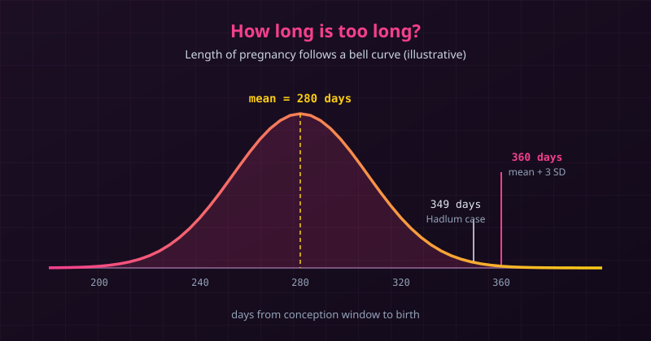

{fig-alt="Bell curve of pregnancy length centred on 280 days. The 349-day Hadlum case and the 360-day mark (mean plus three standard deviations) lie far out in the right tail."}

*This post is an English retelling, with additions, of the Bengali article ["পরিসংখ্যানিক পিতা!"](https://bnstatmania.blogspot.com/2017/09/statistical-father.html) by Dr. Rahmatullah Imon, shared on the earlier Stat Mania blog with his permission. The case details and the study figures below come from Dr. Imon's account unless another source is named.*

Before DNA tests existed, a court that doubted a child's father had very little to go on. One of the most striking answers came from statistics: if a pregnancy lasted *too* long, the husband could not be the father. But how long is too long? A bell curve helped answer that.

---

## A Baby Born 349 Days Later

In the late 1940s a British soldier, Major Hadlum, returned from the war to find that his wife had given birth to a child. Counting from the day he left, the baby arrived **349 days** later. A normal pregnancy lasts about **280 days** (40 weeks), so Hadlum suspected his wife had been unfaithful and petitioned for divorce on that ground.

The court held that such a long pregnancy was unusual but **possible**, so adultery was not proven. This was *Hadlum v Hadlum*, decided in 1948 and upheld on appeal in 1949.

## Why a Single Number Is Not Enough

Other cases followed with gaps of around 340 and 360 days, and the judges had no agreed way to decide them. "Impossible" is a strong word for a biological process, since gestation length varies from one pregnancy to the next. What the courts needed was a **cut-off**, a point beyond which an outcome is so unlikely that we treat it as an *outlier*.

## The Bell Curve Draws the Line

Gestation length is well described by a normal distribution centred near 280 days. The empirical rule says that about **99.7%** of values lie within three standard deviations of the mean. Dr. Imon reports a large British study of more than 13,000 pregnancies that supported this shape, and that applying "mean + 3 SD" put the upper limit at roughly **360 days**. (We could not independently confirm the details of that study, so treat its numbers as Dr. Imon's account.)

Working backwards from the 360-day limit gives a standard deviation of about 27 days. We can check the arithmetic in R:

```r
m <- 280
s <- 80 / 3                      # (360 - 280) / 3, about 26.7 days

pnorm(c(349, 360), m, s, lower.tail = FALSE)
```

```default
[1] 0.00483 0.00135
```

So under this model, only about **0.5%** of pregnancies run past 349 days, and about **0.14%** past 360. Hadlum's case sat at 2.6 standard deviations above the mean, rare but not impossible, while 360 days sits exactly at 3.

::: {.callout-note}
The model is a simplification. Modern studies find that natural gestation varies more widely than the 280-day textbook figure suggests, and the distribution is not perfectly symmetric. The curve above is illustrative, not a medical reference.
:::

## The Court Draws a Line

In *Preston-Jones v Preston-Jones*, a husband had been abroad for about six months, and his wife's child was born roughly **360 days** after the last time they could have met. The trial judge refused the divorce, but the House of Lords, in a decision of December 1950 (reported in 1951), directed that the husband's petition be allowed. One judge in the case had argued that a court should not accept such a pregnancy as possible without direct medical evidence.

It is common to read this as a rule that any child born within 360 days must be the husband's. That is a simplification: the Lords decided one case on its evidence, and the 360-day figure became a practical benchmark rather than a statute. Even so, the idea behind it is a lesson in statistics. A **"three-sigma" limit** turned a vague legal question into a measurable one, and fathers in such cases were sometimes called "statistical fathers".

## What We Can Take from This

- **Outliers are judged against a distribution.** A value of 349 days means little until we know the mean and spread of the data.
- **The three-sigma rule is a convention.** Moving the cut-off to 2.5 or 4 standard deviations changes who is classed as an outlier.
- **Rare is not impossible.** A statistical limit measures how surprising a value is, which is different from proving what happened in one real case.

---

## References and Further Reading

- Imon, R. (2017). [পরিসংখ্যানিক পিতা! (Statistical Father!)](https://bnstatmania.blogspot.com/2017/09/statistical-father.html). Stat Mania (Bengali), 16 September 2017. The main source for this post.
- McKenzie, D. (2014). [Statistical outliers: of baldness and long gestations](https://deanmckenzieconsulting.com/2014/02/09/statistical-outliers-1-baldness-and-long-gestations/). Discusses *Hadlum v Hadlum* and the 360-day limit.
- [*Preston-Jones v Preston-Jones*](https://vlex.co.uk/vid/preston-jones-v-preston-792875057), House of Lords, 14 December 1950; reported at [1951] AC 391.
