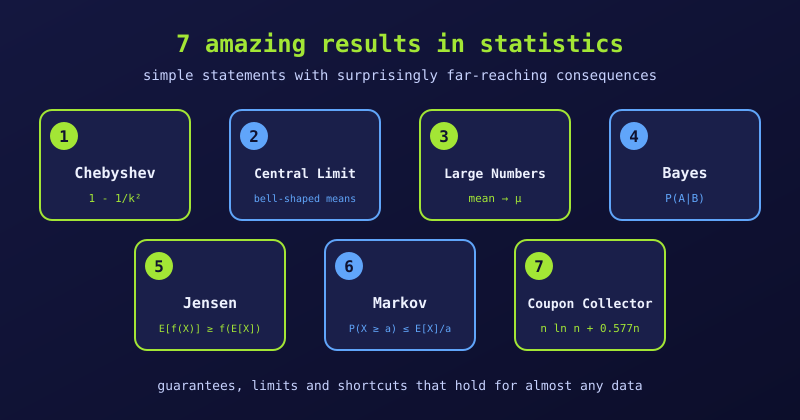

{fig-alt="Seven numbered cards naming Chebyshev's inequality, the Central Limit Theorem, the Law of Large Numbers, Bayes' theorem, Jensen's inequality, Markov's inequality and the Coupon Collector's problem, each with its key formula or idea."}

Some results in statistics are beautiful because a short statement has surprisingly wide consequences. Here are seven of our favourites. For each, we give the idea, then the reason it is amazing.

## 1. Chebyshev's Inequality

For *any* distribution with a finite mean and standard deviation, at least $1 - 1/k^2$ of the data lie within $k$ standard deviations of the mean. So at least 75% lie within 2 standard deviations, and at least 88.9% within 3.

**Why it is amazing:** it needs no assumption about the shape. It is a safety net for skewed, heavy-tailed and U-shaped data alike. We look at it in detail in [Why Chebyshev's Inequality Is Great](why-chebyshev-inequality-is-great.qmd).

## 2. The Central Limit Theorem (CLT)

Take many random samples of the same size and compute each sample mean. As the sample size grows, the distribution of those means approaches a Normal (bell) curve, centred at the population mean, with spread $\sigma/\sqrt{n}$.

**Why it is amazing:** it does not matter whether the original data are skewed, lumpy or discrete. Averages tend to be bell-shaped, which is why the Normal distribution, confidence intervals and many hypothesis tests work so well in practice.

## 3. The Law of Large Numbers (LLN)

While the CLT describes the *shape* of sample averages, the Law of Large Numbers describes their *destination*. As we repeat a random experiment again and again, the sample average converges to the true expected value.

**Why it is amazing:** it turns chaos into predictability. A single roulette spin is unpredictable, yet a casino can forecast its profit margin over millions of bets with very little uncertainty.

## 4. Bayes' Theorem

Bayes' Theorem is the exact rule for updating a belief when new evidence arrives. It flips a conditional probability around, giving the probability of a hidden cause from an observed effect:

$$
P(A \mid B) = \frac{P(B \mid A)\,P(A)}{P(B)}
$$

**Why it is amazing:** it mimics rational learning and powers spam filters, medical diagnosis and many AI methods. It also shows that extraordinary claims need extraordinary evidence. Suppose a disease affects 1 person in 1,000, and a test has 99% sensitivity and 99% specificity. If someone tests positive, how likely is it that they have the disease?

```{r}
prevalence  <- 0.001
sensitivity <- 0.99   # P(positive | disease)
specificity <- 0.99   # P(negative | no disease)

p_positive <- sensitivity * prevalence + (1 - specificity) * (1 - prevalence)
p_disease_given_positive <- sensitivity * prevalence / p_positive
round(p_disease_given_positive, 3)
```

Only about 9% of positive results are true. Most positives are false, because the healthy people vastly outnumber the sick.

## 5. Jensen's Inequality

For a convex function $f$, the average of the outputs is at least the output of the average:

$$
E[f(X)] \ge f(E[X])
$$

For a concave function, the inequality reverses.

**Why it is amazing:** it explains why volatility hurts long-term growth. If an investment gains 50% one year and loses 50% the next, the average return is 0%, yet the money is multiplied by $1.5 \times 0.5 = 0.75$, a **25% loss**. Growth is multiplicative, and the logarithm is concave, so the average of the log-growth falls below the log of the average growth.

## 6. Markov's Inequality

Markov's Inequality is the simpler parent of Chebyshev's. For a non-negative random variable $X$ and any $a > 0$, it bounds the chance of a large value using only the mean:

$$
P(X \ge a) \le \frac{E[X]}{a}
$$

**Why it is amazing:** averages cannot hide a large crowd of extreme values. Knowing nothing else about a country's incomes, Markov's inequality guarantees that no more than $1/5 = 20\%$ of the population can earn 5 or more times the national average.

## 7. The Coupon Collector's Problem (and Linearity of Expectation)

Linearity of Expectation says that

$$
E[X + Y] = E[X] + E[Y]
$$

and it holds even when $X$ and $Y$ are dependent. Using it, we can find how many random draws are needed to collect all $n$ distinct items: about $n \ln n + 0.577\,n$.

**Why it is amazing:** it replaces tangled dependency arguments with simple addition. It also shows why the last missing item takes so long. The first item is certain, but when only one item is missing, each draw finds it with chance $1/n$, so we expect $n$ draws for that item alone.

We can check the formula by simulation. Take $n = 50$ distinct items and repeat the collection 10,000 times:

```{r}
set.seed(123)
n <- 50

draws_to_complete <- function(n) {
  seen <- rep(FALSE, n)
  draws <- 0
  while (!all(seen)) {
    seen[sample.int(n, 1)] <- TRUE
    draws <- draws + 1
  }
  draws
}

sim <- replicate(10000, draws_to_complete(n))
c(simulated = mean(sim), formula = n * log(n) + 0.5772 * n)
```

## Summary Comparison

| Result | What we need to know | What it guarantees |
|:--|:--|:--|
| Chebyshev's Inequality | Finite mean and standard deviation | At least $1 - 1/k^2$ of the data lie within $k$ standard deviations of the mean. |
| Central Limit Theorem | Independent samples with finite variance | Sample means become approximately Normal as the sample grows. |
| Law of Large Numbers | Finite mean | Sample averages converge to the true average. |
| Bayes' Theorem | Prior probability and test accuracy | The exact updated probability after seeing new evidence. |
| Jensen's Inequality | Mean and curve direction (convex or concave) | Applying a curve to a random variable shifts the average away from the curve of the average. |
| Markov's Inequality | Only a non-negative mean | A hard ceiling on the share of extreme high values. |
| Linearity of Expectation | Individual averages only | Averages add up cleanly, even when events are tangled together. |
