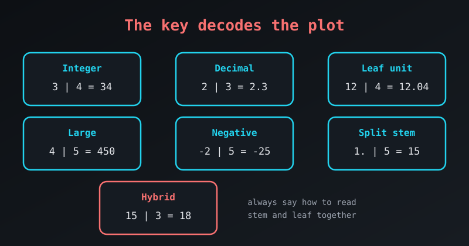

{fig-alt="Cards showing key styles: integer 3 | 4 = 34, decimal 2 | 3 = 2.3, leaf unit 12 | 4 = 12.04, large 4 | 5 = 450, negative -2 | 5 = -25, split stem 1. | 5 = 15 and hybrid 15 | 3 = 18."}

The **key** is what makes a stem-and-leaf plot readable. Without it the plot is just a column of digits. The key tells the reader how to combine the stem (left column) and the leaf (right column) to recover the original value.

Data come as decimals, huge numbers and negative values, so the key has to adapt. Here are the common variants and when to use each.

## 1. The Standard Integer Key

The classic version, for ordinary whole numbers.

- **When to use:** counts, ages, or test scores out of 100.

```default
Stem | Leaf
  2  | 1 5 8
  3  | 0 4 4 9
  4  | 2

Key: 3 | 4 means 34
```

## 2. The Decimal Key

When the data have decimals, the stem is the whole-number part and the leaf is the decimal digit.

- **When to use:** GPAs, measurements such as height in metres, financial figures.

```default
Stem | Leaf
  1  | 2 5
  2  | 1 3 8
  3  | 0

Key: 2 | 3 means 2.3
```

## 3. The Formal "Leaf Unit" Key

Statistical software and scientific papers often state a **leaf unit**: the value of one step in the leaf.

- **When to use:** formal reports, or data with two or more decimal places.

```default
Stem | Leaf
 12  | 4 7
 13  | 1 9

Leaf unit = 0.01
```

To read it: `12 | 4` is 12 + (4 × 0.01) = 12.04.

## 4. The Large-Number Key

Populations, sales or distances are too large to write in full, so we drop the trailing digits and say so in the key.

- **When to use:** values in the hundreds, thousands or millions.

```default
Stem | Leaf
  4  | 5 8
  5  | 2 3

Key: 4 | 5 means 450
```

Here the leaves are tens, so the plot shows 450, 480, 520 and 530.

## 5. The Negative-Number Key

Stem-and-leaf plots can handle negative values. The minus sign belongs to the whole number, and the stems run from the most negative to the most positive.

- **When to use:** temperatures, financial losses, altitudes below sea level.

```default
Stem | Leaf
 -2  | 5 8
 -1  | 2 4
  0  | 1
  1  | 5

Key: -2 | 5 means -25
```

## 6. The Split-Stem Key

When too many leaves pile up on one stem, we split the stem in two: `1*` for the low half (10–14) and `1.` for the high half (15–19). Leaves are still just the units digit.

- **When to use:** a standard plot hides the shape because one stem has too many leaves.

```default
Stem | Leaf
  1* | 2 4
  1. | 5 7 9
  2* | 1 3

Key: 1. | 5 means 15
```

## 7. The Hybrid Key (Stems of 5)

The hybrid plot gets the same finer bins as the split stem, but writes the stems as numbers (`10`, `15`, `20`) and each leaf is the **offset** from its stem.

```default
Stem | Leaf
 10  | 2 3 3
 15  | 0 0 2 2 3 3 3 3 4
 20  | 0 1 3 3 3 3 4

Key: 15 | 3 means 15 + 3 = 18
```

The reader has to add the stem and the leaf, so the key must be clear. See [Hybrid Stem-and-Leaf Plot](hybrid-stem-and-leaf-plot.qmd) for the full example.

## R Prints Its Own Key

R's `stem()` function writes the key as a sentence above the plot. For large numbers:

```r
stem(c(450, 480, 520, 530, 560, 610))
```

```default
  The decimal point is 2 digit(s) to the right of the |

  4 | 58
  5 | 23
  5 | 6
  6 | 1
```

"2 digits to the right" means each stem is in hundreds, so `4 | 5` is 450 and `4 | 8` is 480. Notice that R also split the stem 5 into two rows, as in the split-stem variant.

## Cheat Sheet: Which Key to Use

| Data type | Key variant | Example |
|---|---|---|
| Whole numbers | Standard integer | Key: 3 \| 4 = 34 |
| Decimals (1 place) | Decimal | Key: 3 \| 4 = 3.4 |
| Decimals (2+ places) | Leaf unit | Leaf unit = 0.01 |
| Large numbers | Scaled | Key: 4 \| 5 = 450 |
| Negative values | Negative | Key: -2 \| 5 = -25 |
| Crowded stems | Split stem | Key: 1. \| 5 = 15 |
| Crowded stems, numeric stems | Hybrid | Key: 15 \| 3 = 15 + 3 = 18 |

::: {.callout-tip}
**The golden rule:** a key must be unambiguous. If there is any way a reader could misread the digits, make the key more specific.
:::
