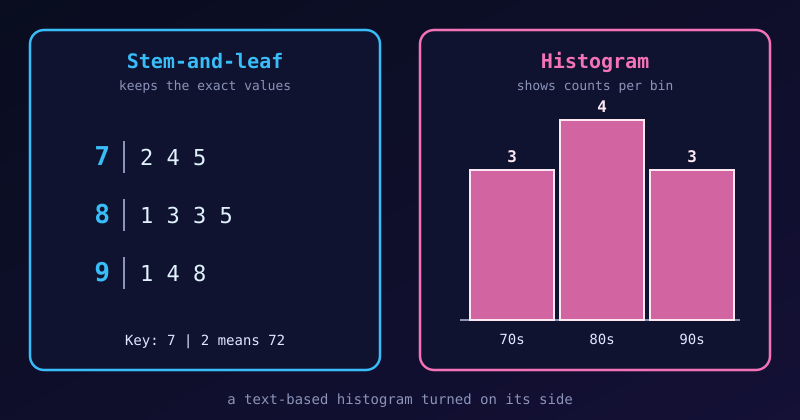

{fig-alt="A stem-and-leaf plot of ten scores beside a histogram of the same scores with bars of height 3, 4 and 3."}

Stem-and-leaf plots and histograms both show the distribution of quantitative data. A stem-and-leaf plot is often described as a **text-based histogram turned on its side**. They serve slightly different purposes, depending on the size of the dataset and what we want to emphasise.

## How They Are Similar

1. **They show the shape of the data.** We can see whether the data are symmetric, skewed to the left or right, or have several peaks.
2. **They group data into intervals.** A histogram calls them *bins* (such as 70–79). A stem-and-leaf plot uses the *stems* (such as the tens digit).
3. **They display frequency.** In a histogram it is the **height** of a bar; in a stem-and-leaf plot it is the **length** of a row of leaves.
4. **They are for quantitative data.** Neither suits categories such as eye colour or car brand.

## How They Differ

| Feature | Stem-and-leaf plot | Histogram |
|---|---|---|
| Data retention | **Keeps the exact values** in the leaves | **Loses the exact values**: a bar only gives a count |
| Visual format | Digits form the "bars" | Solid rectangular bars |
| Class intervals | Set by place value (tens, hundreds, ...) | Bin width chosen freely |
| Dataset size | Small to medium (about 15–50 values) | Large (hundreds or thousands) |
| Finding the median | Easy: count to the middle leaf | Harder: estimate inside a bar |
| Ordering | Sorted leaves give the exact rank of every value | Individual points are lost, so no exact rank |

## An Example with Ten Scores

Here are ten test scores:

```r
scores <- c(72, 74, 75, 81, 83, 83, 85, 91, 94, 98)
```

### As a stem-and-leaf plot

```r
stem(scores)
```

```default
  The decimal point is 1 digit(s) to the right of the |

  7 | 245
  8 | 1335
  9 | 148
```

Key: `7 | 2` means 72. We can read every score, see that the most common one is 83, and find the median by counting to the middle:

```r
median(scores)
```

```default
[1] 83
```

### As a histogram

```{r}
#| fig-width: 6
#| fig-height: 4
library(ggplot2)

scores <- c(72, 74, 75, 81, 83, 83, 85, 91, 94, 98)

ggplot(data.frame(scores), aes(scores)) +
  geom_histogram(binwidth = 10, boundary = 70, closed = "left",
                 fill = "steelblue", colour = "white") +
  stat_bin(binwidth = 10, boundary = 70, closed = "left",
           geom = "text", aes(label = after_stat(count)), vjust = -0.5) +
  scale_x_continuous(breaks = seq(70, 100, 10)) +
  scale_y_continuous(limits = c(0, 5), expand = c(0, 0)) +
  labs(title = "Histogram of ten test scores",
       x = "Score", y = "Frequency") +
  theme_classic(base_size = 13) +
  theme(axis.ticks = element_blank(),
        axis.line = element_line(colour = "grey60"),
        panel.grid.major.y = element_line(colour = "grey90"))
```

The histogram gives the general shape and the counts (3, 4 and 3). But if we ask "did anyone score 85?", the bars cannot tell us. The stem-and-leaf plot can: there is an `8 | 5`.

## When the Dataset Gets Large

With a few dozen values the stem-and-leaf plot is compact. With hundreds, the rows of leaves become very long. Here are 200 simulated scores:

```{r}
set.seed(7)
big <- round(rnorm(200, mean = 70, sd = 12))

stem(big)
```

It still works, but the rows are crowded and hard to scan. The histogram handles the same data cleanly:

```{r}
#| fig-width: 6.5
#| fig-height: 4
ggplot(data.frame(big), aes(big)) +
  geom_histogram(binwidth = 5, boundary = 0,
                 fill = "steelblue", colour = "white") +
  scale_y_continuous(expand = expansion(mult = c(0, 0.05))) +
  labs(title = "Histogram of 200 scores",
       x = "Score", y = "Frequency") +
  theme_classic(base_size = 13) +
  theme(axis.ticks = element_blank(),
        axis.line = element_line(colour = "grey60"),
        panel.grid.major.y = element_line(colour = "grey90"))
```

## Summary

- Use a **stem-and-leaf plot** for a small dataset when we want to see the shape *without losing the original numbers*.
- Use a **histogram** for a large dataset when only the overall distribution pattern matters.

If a stem-and-leaf plot gives too few rows, see [Hybrid Stem-and-Leaf Plot](hybrid-stem-and-leaf-plot.qmd), which uses stems of 5.
