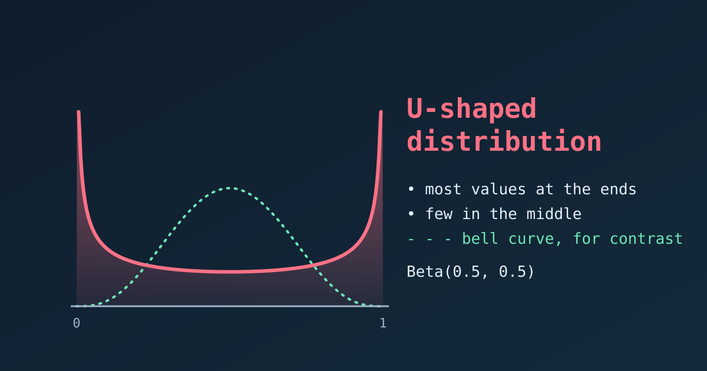

{fig-alt="A U-shaped Beta(0.5, 0.5) density that is high at both ends and low in the middle, with a dashed bell curve peaking in the middle for contrast."}

A **U-shaped distribution** exists, and it is the opposite of a bell curve. Most of the observations lie near the two extremes of the scale, and very few fall in the middle. On a histogram or density plot it forms a literal "U".

## Key Features

- **Two peaks at the extremes.** The highest density is at the minimum and the maximum, and the lowest is in the middle. (Strictly, the ends are the modes, and the middle is the least likely region.)
- **Large spread.** Values are pushed away from the centre, so the variance is large for the range of the data.
- **A misleading average.** The mean usually sits in the middle, exactly where few observations are. It describes almost nobody.
- **Polarisation.** The shape signals scenarios with little or no middle ground.

::: {.callout-note}
## In plain words

The lowest and the highest values are by far the most common, and the middle values are rare. Imagine the marks of a group of students: most students got either very poor or very good marks, and few got average marks.
:::

## Real-World Examples

### Customer reviews

Online product ratings often look U-shaped. Customers with an average experience rarely write a review, while those with an extreme experience feel motivated to.

- **Left peak:** broken items or terrible service (1-star reviews).
- **Right peak:** customers who loved the product (5-star reviews).
- **The dip:** very few 2, 3 or 4-star reviews.

### Political opinion

On a controversial law, opinion in a polarised climate can split into two camps.

- **Left peak:** voters who strongly oppose it.
- **Right peak:** voters who strongly support it.
- **The dip:** few moderate or undecided voters.

### Cloud cover

Cloud cover is measured in oktas, from 0 (clear sky) to 8 (fully overcast). In many places the sky tends to be either clear or overcast.

- **Left peak:** clear days (0 oktas).
- **Right peak:** fully overcast days (8 oktas).
- **The dip:** days with intermediate cover are comparatively rare.

## The Mathematical Model: Beta Distribution

A U shape on the interval from 0 to 1 is most commonly modelled with the **Beta distribution**, $\text{Beta}(\alpha, \beta)$, whose density is

$$
f(x) = \frac{x^{\alpha - 1} (1 - x)^{\beta - 1}}{B(\alpha, \beta)}, \qquad 0 < x < 1.
$$

When both shape parameters are below one ($\alpha < 1$ and $\beta < 1$), the exponents $\alpha - 1$ and $\beta - 1$ are negative. The density then shoots up towards infinity at $x = 0$ and $x = 1$ and dips in the middle. The case $\text{Beta}(0.5, 0.5)$ is also called the **arcsine distribution**.

| Shape parameters | Shape of the density |
|---|---|
| $\alpha < 1$, $\beta < 1$ | U-shaped |
| $\alpha = \beta = 1$ | Flat (uniform) |
| $\alpha > 1$, $\beta > 1$ | Bell-shaped (one peak inside) |
| $\alpha < 1$, $\beta \ge 1$ (or the reverse) | J-shaped (one peak at one end) |

## Plotting the U Shape in R

First we draw the density of $\text{Beta}(0.5, 0.5)$ with `dbeta()`. The density is infinite at exactly 0 and 1, so we plot just inside the interval and cut the vertical axis.

```{r}
#| fig-width: 6.5
#| fig-height: 4
library(tidyverse)

x <- seq(0.003, 0.997, length.out = 1000)
u <- tibble(x = x, density = dbeta(x, 0.5, 0.5))

ggplot(u, aes(x, density)) +
  geom_line(colour = "royalblue", linewidth = 1.2) +
  coord_cartesian(ylim = c(0, 4)) +
  labs(title = "U-shaped Beta(0.5, 0.5) density", x = "Value", y = "Density")
```

### Comparing Four Beta Shapes

Changing the parameters moves us between the shapes in the table above.

```{r}
#| fig-width: 8
#| fig-height: 5
shapes <- tibble(a = c(0.5, 1, 4, 0.5), b = c(0.5, 1, 4, 3)) %>%
  mutate(label = factor(sprintf("Beta(%g, %g)", a, b), levels = sprintf("Beta(%g, %g)", a, b))) %>%
  crossing(x = seq(0.01, 0.99, length.out = 400)) %>%
  mutate(density = dbeta(x, a, b))

ggplot(shapes, aes(x, density)) +
  geom_line(colour = "royalblue", linewidth = 1) +
  facet_wrap(~ label) +
  coord_cartesian(ylim = c(0, 4)) +
  labs(title = "From U-shaped to J-shaped to bell-shaped", x = "Value", y = "Density")
```

## Simulating U-Shaped Data

We draw random values with `rbeta()` and compare the histogram with the true density.

```{r}
#| fig-width: 6.5
#| fig-height: 4
set.seed(1)
sim <- tibble(value = rbeta(10000, 0.5, 0.5))

ggplot(sim, aes(value)) +
  geom_histogram(aes(y = after_stat(density)), bins = 40,
                 fill = "lightblue", colour = "white") +
  geom_line(data = u, aes(x, density), colour = "royalblue", linewidth = 1) +
  coord_cartesian(ylim = c(0, 4)) +
  labs(title = "Simulated U-shaped data", x = "Value", y = "Density")
```

## The Mean Hides the Story

For this data the mean is about 0.5, the centre of the scale. Let's see how many observations are actually near it.

```{r}
mean(sim$value)

# share of values in the middle fifth, 0.4 to 0.6
mean(sim$value > 0.4 & sim$value < 0.6)

# share of values in the outer fifths (below 0.1 or above 0.9)
mean(sim$value < 0.1 | sim$value > 0.9)
```

A flat (uniform) distribution would put 20% of values in the middle fifth, and a bell curve far more. Here only about 13% are there, while about 41% lie in the outer tenths at the two ends. The average describes a value that few observations are close to.

::: {.callout-tip}
When a histogram looks U-shaped, report the two groups separately, or the share in each tail, instead of a single mean and standard deviation.
:::

## Summary

- A U-shaped distribution has its highest density at both extremes and its lowest in the middle.
- It appears when a population splits into two camps, as in polarised opinions or extreme ratings.
- The Beta distribution with both shape parameters below one is the standard model.
- The mean is a poor summary, so describe the two ends instead.
