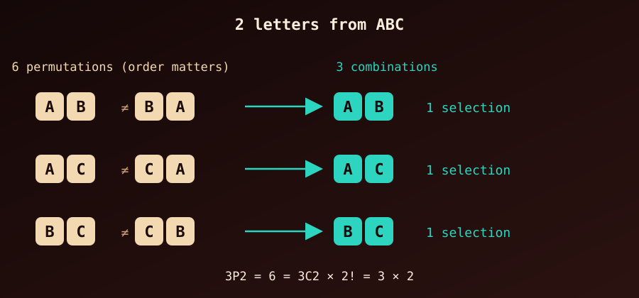

{fig-alt="Ordered pairs AB, BA, AC, CA, BC and CB, grouped in twos, each group pointing to a single unordered selection: AB, AC or BC."}

Two ideas sit behind most counting problems: **arranging** items and **selecting** them. We separate them on a tiny example first.

## Permutation: order matters

How many ways can we arrange 2 letters taken from $A, B, C$?

$$
AB,\; BA,\; AC,\; CA,\; BC,\; CB
$$

That is **6** arrangements. A permutation is an arrangement, so $AB$ and $BA$ are different.

## Combination: order does not matter

A combination is a selection, like choosing members for a team. Now we only ask *which* 2 letters are chosen:

$$
\{A, B\}, \quad \{A, C\}, \quad \{B, C\}
$$

That is **3** selections. Each one stands for two permutations: $\{A, B\}$ covers $AB$ and $BA$, $\{A, C\}$ covers $AC$ and $CA$, and $\{B, C\}$ covers $BC$ and $CB$.

So

$$
\underbrace{6}_{^{3}P_{2}} = \underbrace{3}_{^{3}C_{2}} \times \underbrace{2!}_{\text{orders of each pair}}
$$

## Both together: a 15-player squad

A team needs 11 players from a squad of 15, and then the 11 are placed in specific positions on the ground.

1. **Select** the players: $^{15}C_{11} = 1365$ ways.
2. **Arrange** the chosen 11: $11! = 39{,}916{,}800$ ways.
3. By the counting rule, we multiply the two stages:

$$
\begin{aligned}
{}^{15}C_{11} \times 11! &= 1365 \times 39{,}916{,}800 \\
&= 54{,}486{,}432{,}000
\end{aligned}
$$

This is also the number of ways to arrange 11 players out of 15 directly, $^{15}P_{11}$. It is the same relationship we saw with the letters:

$$
{}^{n}P_{r} = {}^{n}C_{r} \times r!
$$

This is an example of permutations and combinations used together, and also of the **counting rule**, which tells us when to multiply the number of ways. The counting rule itself, and when to add instead, is the subject of [Counting Rule and Addition Rule: When to Add and When to Multiply](counting-rule-and-addition-rule-when-to-add-and-multiply.html).

## The box method for permutations

There is a quick way to count permutations without a formula. Suppose we have 4 items, $A, B, C, D$, and want to arrange 3 of them, with no item used twice.

Draw one box for each position:

$$
\boxed{\phantom{4}} \;\; \boxed{\phantom{4}} \;\; \boxed{\phantom{4}}
$$

- The first box can take any of the 4 items.
- Once one is used, 3 items are left for the second box.
- Then 2 items are left for the third box.

$$
\boxed{4} \;\; \boxed{3} \;\; \boxed{2}
\quad\Longrightarrow\quad 4 \times 3 \times 2 = 24
$$

We multiply because each box is an incomplete choice, exactly as the counting rule says (see [Counting Rule and Addition Rule](counting-rule-and-addition-rule-when-to-add-and-multiply.html)). The result is the same as $^{4}P_{3} = 24$.

### When items can be repeated

If repetition is allowed, as with the digits of a number, nothing is used up. Every box has all 4 choices:

$$
\boxed{4} \;\; \boxed{4} \;\; \boxed{4}
\quad\Longrightarrow\quad 4 \times 4 \times 4 = 4^3 = 64
$$

In general, $r$ boxes with $n$ choices each give $n^r$ arrangements.

## Why it matters in real life: phone numbers

Mobile numbers in Bangladesh once had 9 digits: a 3-digit operator code (such as 019 or 017) followed by 6 digits. Each of the 6 positions can hold any of the 10 digits, so one code could supply

$$
10^6 = 1{,}000{,}000 \text{ numbers (10 lakh).}
$$

That was not enough for such a large population, so one more digit was added:

$$
10^7 = 10{,}000{,}000 \text{ numbers (1 crore).}
$$

That was still not enough, so the numbers grew to 11 digits:

$$
10^8 = 100{,}000{,}000 \text{ numbers (10 crore) per code.}
$$

Many operators now hold two codes (for example 017 and 013), which doubles the supply to 20 crore numbers. Each extra digit multiplies the capacity by 10, which is why counting arguments like this matter for planning.

## Where to go next

- Many problems need both steps with several categories of items, such as a fixed mix of batsmen and bowlers: see [When Permutations and Combinations Work Together](cases-when-permutation-and-combinations-apply-together.html).
- If some items must always be in the selection, or must always be left out, the pool and spots shrink: see [Combinations When Some Items Are Always Selected or Always Omitted](combination-always-selecting-omitting.html).

