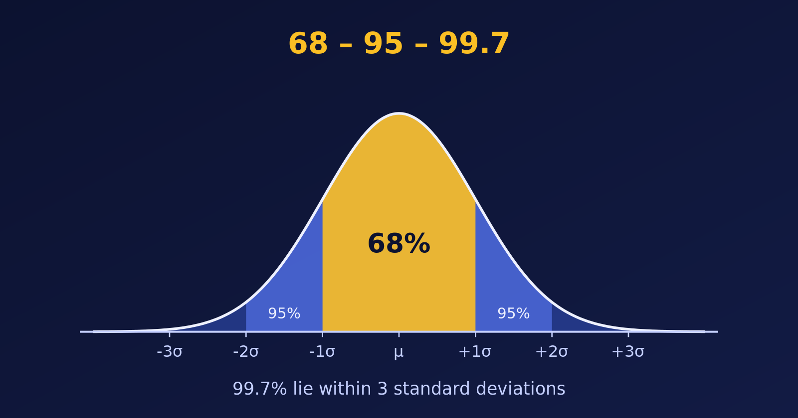

{.bk-adapt fig-alt="A bell curve divided into bands. The central band within one standard deviation holds 68 percent, within two holds 95 percent and within three holds 99.7 percent."}

The **Empirical Rule**, also called the 68-95-99.7 rule, tells us how data spread around the mean when the distribution is bell-shaped (normal). Let's state it, check it with a simulation in R, and then draw it.

## An Example First

Suppose the marks of a large group of students are bell-shaped, with a mean of $\mu = 70$ and a standard deviation of $\sigma = 5$. The Empirical Rule then says:

- about $68\%$ of the students score within one standard deviation of the mean: between $\mu - \sigma = 65$ and $\mu + \sigma = 75$,
- about $95\%$ score within two standard deviations: between $\mu - 2\sigma = 60$ and $\mu + 2\sigma = 80$,
- about $99.7\%$, almost everyone, score within three standard deviations: between $\mu - 3\sigma = 55$ and $\mu + 3\sigma = 85$.

So a mark below $55$ or above $85$ is very unusual: fewer than $3$ students in $1{,}000$.

## The Empirical Rule

For a normally distributed data set with mean $\mu$ and standard deviation $\sigma$:

| Range | Share of the data |
|---|---|
| $[\mu - \sigma, \; \mu + \sigma]$ | about $68\%$ |
| $[\mu - 2\sigma, \; \mu + 2\sigma]$ | about $95\%$ |
| $[\mu - 3\sigma, \; \mu + 3\sigma]$ | about $99.7\%$ |

So nearly all the data lie within three standard deviations of the mean, and values further away are rare.

## Checking the Rule with Simulated Data

Let's simulate $10{,}000$ exam marks like these, with mean $70$ and standard deviation $5$, and measure the share of marks within one, two and three standard deviations.

```{r}
library(tidyverse)

set.seed(42)
scores <- rnorm(n = 10000, mean = 70, sd = 5)

mean_val <- mean(scores)
sd_val   <- sd(scores)

within <- function(k) mean(scores >= mean_val - k * sd_val &
                           scores <= mean_val + k * sd_val) * 100

tibble(sd_range = c("1 SD", "2 SD", "3 SD"),
       simulated = round(map_dbl(1:3, within), 2),
       theory    = round((pnorm(1:3) - pnorm(-(1:3))) * 100, 2)) %>%
  knitr::kable()
```

The simulated percentages are very close to the theoretical ones. The theory column is exact: $68.27\%$, $95.45\%$ and $99.73\%$. The familiar $68$, $95$ and $99.7$ are rounded versions of these.

## Visualizing the Results

First, the histogram of the scores, with lines at one, two and three standard deviations from the mean.

```{r}
#| fig-width: 7
#| fig-height: 4.2
breaks <- mean_val + (-3:3) * sd_val

ggplot(tibble(scores), aes(scores)) +
  geom_histogram(aes(y = after_stat(density)), binwidth = 1,
                 fill = "lightblue", colour = "white") +
  stat_function(fun = dnorm, args = list(mean = mean_val, sd = sd_val),
                colour = "royalblue", linewidth = 1) +
  geom_vline(xintercept = breaks, linetype = "dashed", colour = "grey30") +
  scale_x_continuous(breaks = round(breaks)) +
  labs(title = "10,000 simulated exam marks", x = "Mark", y = "Density")
```

Now the curve itself, with the three bands shaded. The darker the shade, the closer to the mean.

```{r}
#| fig-width: 7
#| fig-height: 4.2
curve <- tibble(x = seq(-4, 4, length.out = 800), density = dnorm(x))

ggplot(curve, aes(x, density)) +
  geom_area(fill = "#cfe3f5") +
  geom_area(data = filter(curve, abs(x) <= 2), fill = "#8fbfe8") +
  geom_area(data = filter(curve, abs(x) <= 1), fill = "#4a90d9") +
  geom_line() +
  annotate("text", x = 0,    y = 0.15, label = "68%",   colour = "white", size = 6) +
  annotate("text", x = 1.5,  y = 0.05, label = "95%",   size = 4) +
  annotate("text", x = -1.5, y = 0.05, label = "95%",   size = 4) +
  annotate("text", x = 0,    y = 0.43, label = "99.7% lie within 3 SD", size = 4) +
  scale_x_continuous(breaks = -3:3, labels = c("-3σ", "-2σ", "-1σ", "μ", "+1σ", "+2σ", "+3σ")) +
  labs(title = "The Empirical Rule", x = NULL, y = "Density")
```

The "95%" labels mark the whole region within two standard deviations, which includes the central $68\%$.

::: {.callout-warning}
The rule applies to **bell-shaped** data. For skewed or heavy-tailed data the percentages can be quite different, so check the shape with a histogram first.
:::

## Summary

- The Empirical Rule gives $68\%$, $95\%$ and $99.7\%$ for one, two and three standard deviations.
- A simulation with `rnorm()` confirms it: $68.29\%$, $95.53\%$ and $99.73\%$ in our sample.
- Shaded areas under the normal curve are the clearest way to show it.
