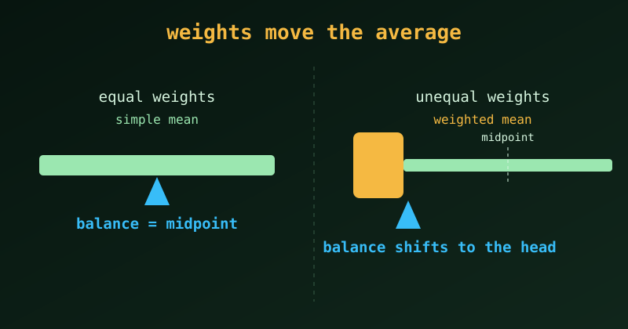

{fig-alt="Left: a uniform bar balanced at its midpoint. Right: a hammer with a heavy head, balanced near the head, away from its midpoint."}

## Starting with the simple mean

Let's consider this data:

```default
2, 4, 6
```

The arithmetic mean is 4, since (2 + 4 + 6) / 3 = 4. Here every value counts equally.

## When values are not equally important

Now let's say these are marks given by three judges to a participant in a competition. The first judge is more experienced, so whatever that judge gives should carry more weight. We multiply each mark by a weight:

| Judge | Mark ($x$) | Weight ($w$) |
|:-----:|:----------:|:------------:|
| 1     | 2          | 2            |
| 2     | 4          | 1.5          |
| 3     | 6          | 1            |

The average now tilts toward the marks with more weight. Like a hammer, more weight on one side shifts the centre of gravity.

## The formula

The weighted average is the sum of each value times its weight, divided by the sum of the weights:

$$
\bar{x}_w = \frac{\sum_{i=1}^{n} w_i x_i}{\sum_{i=1}^{n} w_i}
$$

Dividing by the total weight keeps the result on the same scale as the data. If all weights are equal, it reduces to the ordinary mean.

## Example 1: the judges

| Judge | Mark ($x$) | Weight ($w$) | $w \times x$ |
|:-----:|:----------:|:------------:|:------------:|
| 1     | 2          | 2            | 4            |
| 2     | 4          | 1.5          | 6            |
| 3     | 6          | 1            | 6            |
| **Total** |        | **4.5**      | **16**       |

$$
\bar{x}_w = \frac{2 \times 2 + 4 \times 1.5 + 6 \times 1}{2 + 1.5 + 1} = \frac{4 + 6 + 6}{4.5} = \frac{16}{4.5} \approx 3.56
$$

The weighted average (3.56) is lower than the simple mean (4), because the lowest mark came from the most trusted judge.

## Example 2: course grades

A student scores 90 in Math (4 credits), 80 in English (3 credits) and 70 in Art (2 credits). The simple mean is 80, but a 4-credit course should count more than a 2-credit one.

| Course | Score ($x$) | Credits ($w$) | $w \times x$ |
|:------:|:-----------:|:-------------:|:------------:|
| Math   | 90          | 4             | 360          |
| English | 80         | 3             | 240          |
| Art    | 70          | 2             | 140          |
| **Total** |          | **9**         | **740**      |

$$
\bar{x}_w = \frac{90 \times 4 + 80 \times 3 + 70 \times 2}{4 + 3 + 2} = \frac{360 + 240 + 140}{9} = \frac{740}{9} \approx 82.22
$$

The weighted average is higher than the simple mean, since the best score sits in the heaviest course.

::: {.callout-note}
Weights need not add up to 1 or 100. Dividing by $\sum w$ takes care of that. If they do sum to 1 (for example 0.5, 0.3, 0.2), the denominator is 1 and the average is just $\sum w_i x_i$.
:::

## Key takeaway

- Use the simple mean when every value is equally important.
- Use a weighted average when some values matter more (expert judges, credit hours, group sizes).
- The result always lies between the smallest and largest value, pulled toward the heaviest weights.
