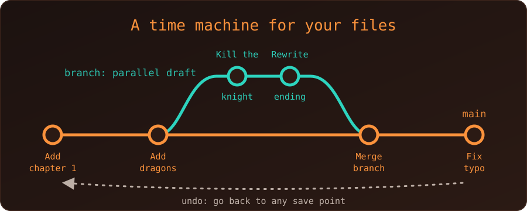

{fig-alt="A timeline of four commits on the main line. A second branch splits off after the second commit, holds two commits of its own and merges back. A dotted arrow below points back along the timeline to show undo."}

Think of Git as an **"Undo" button and a time machine for a folder of files**, combined with a way for several people to work on the same project without stepping on each other's toes.

We do not need to know how to code to understand it. Let's imagine we are writing a book with a few friends.

## The old way, without Git

We write Chapter 1. A friend wants to add a paragraph, so we email them the file. They edit it and send it back. Soon the folder holds:

- `Book_v1.docx`
- `Book_v2_final.docx`
- `Book_final_ACTUAL_final.docx`

If someone makes a mistake, we dig through old copies to find the good version. If two people edit the same page at once, merging their work by hand is a nightmare.

## The Git way

Instead of passing copies of the whole book around, Git acts as a **record keeper** for the project. Four ideas cover most of it.

### 1. Commit: a save point

A *commit* is a snapshot of the project at one moment, saved together with a short note.

- We write a paragraph and commit it with the note *"Added a paragraph about dragons."*
- We fix a typo and commit again: *"Fixed a typo in Chapter 1."*

The result is a timeline of every change, who made it, when, and why. If we break something, we can go back to any earlier point.

### 2. Branch: a parallel universe

Suppose we want to kill off a character in Chapter 5, but a co-author wants to keep them alive. Instead of arguing, each of us creates a *branch*. We make our changes in our own universe, and the original book stays untouched until we decide otherwise.

### 3. Merge: bringing the work together

When both of us are done, we *merge* the branches back into the main timeline. Git compares the versions and combines the changes automatically. If we both edited the same sentence in different ways, Git does not guess. It flags a *conflict* and asks us to choose which version to keep, so nobody's work is silently deleted.

### 4. Repository: the project and its memory

A *repository* (or *repo*) is the project folder together with its whole history. It can live on our computer, and a copy can live on a hosting site such as GitHub, which is how friends share and sync their work.

## What it looks like in practice

We said no code was needed, but here is the same story as real commands, in a new folder. We ran them to produce the output shown.

```bash
git init                                  # start a repository
echo "Chapter 1" > book.txt
git add book.txt                          # choose what goes into the snapshot
git commit -m "Add chapter 1"             # save it

echo "A dragon appears." >> book.txt
git commit -am "Add a paragraph about dragons"

git switch -c kill-character              # a new branch
echo "The knight dies." >> book.txt
git commit -am "Kill the knight in chapter 5"

git switch main                           # back to the main timeline
git merge kill-character                  # bring the branch in
git log --oneline
```

```
87cfb6f Kill the knight in chapter 5
7d36f0c Add a paragraph about dragons
d230ff8 Add chapter 1
```

Each line is one save point with its note. The branch name `main` may be `master` in older repositories.

## What is it used for?

Developers use Git for code, but it works for **anything made of text files**:

- writing a novel, a thesis or a report (including LaTeX and Quarto documents)
- a collection of notes, such as an Obsidian vault
- configuration files
- a website like this blog

Git is less helpful for large binary files such as videos or Word documents, because it cannot show or merge their changes line by line.

::: {.callout-note}
Git and GitHub are different things. Git is the tool that tracks history on our computer. GitHub is a website that stores repositories online and adds collaboration features.
:::

## Summary

Git takes a folder and gives it a searchable memory. Commits are save points, branches let us experiment safely, and merges bring the results together. Because we can always go back, we can try things without fear, and teams can work on one project at the same time without chaos.
