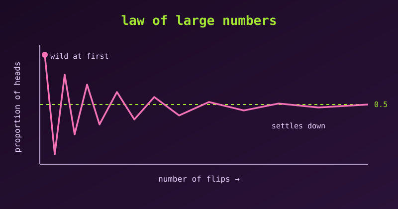

{fig-alt="A line chart of the running proportion of heads against the number of flips: large swings at first, then settling toward the 0.5 line."}

## What it says

The **law of large numbers** (LLN) says that as we collect more independent observations from the same distribution, the sample mean gets closer to the true mean:

$$
\bar{X}_n = \frac{X_1 + X_2 + \cdots + X_n}{n} \;\longrightarrow\; \mu \quad \text{as } n \to \infty
$$

For a fair coin, let $X = 1$ for heads and $0$ for tails. Then $\mu = 0.5$, and the proportion of heads should approach 0.5 as we flip more.

## Seeing it in R

Let's flip a fair coin 10,000 times and look at the running proportion of heads.

```r
library(ggplot2)

set.seed(42)
n <- 10000
flips <- rbinom(n, 1, 0.5)
running <- cumsum(flips) / seq_len(n)

df <- data.frame(n = seq_len(n), prop = running)

ggplot(df, aes(n, prop)) +
  geom_line(colour = "steelblue") +
  geom_hline(yintercept = 0.5, linetype = "dashed", colour = "red") +
  scale_x_log10() +
  labs(x = "Number of flips (log scale)", y = "Proportion of heads")
```

```{r}
#| echo: false
#| fig-alt: "Running proportion of heads against the number of flips on a log scale: it fluctuates widely for small n and settles close to 0.5 for large n."
library(ggplot2)

set.seed(42)
n <- 10000
flips <- rbinom(n, 1, 0.5)
running <- cumsum(flips) / seq_len(n)

df <- data.frame(n = seq_len(n), prop = running)

ggplot(df, aes(n, prop)) +
  geom_line(colour = "steelblue") +
  geom_hline(yintercept = 0.5, linetype = "dashed", colour = "red") +
  scale_x_log10() +
  labs(x = "Number of flips (log scale)", y = "Proportion of heads")
```

The values at a few sample sizes:

```{r}
#| echo: false
k <- c(10, 100, 1000, 10000)
data.frame(n = k, heads = cumsum(flips)[k], proportion = round(running[k], 4))
```

With 10 flips the proportion is far from 0.5; with 10,000 it is very close.

## What it is not

### 1. It is not the gambler's fallacy

After five heads in a row, tails is **not** "due". The coin has no memory, and the next flip is still 50/50. The LLN does not say the past is corrected; it says the early streak gets **diluted** by the many flips that follow.

### 2. It does not say counts even out

The *proportion* approaches 0.5, but the *difference* between heads and tails does not shrink. It typically grows, like $\sqrt{n}$. Let's check by repeating the experiment 5,000 times for each $n$:

```r
set.seed(1)
sizes <- c(100, 10000, 1000000)
sapply(sizes, function(n) {
  heads <- rbinom(5000, n, 0.5)
  mean(abs(2 * heads - n))
})
```

```{r}
#| echo: false
set.seed(1)
sizes <- c(100, 10000, 1000000)
res <- sapply(sizes, function(n) {
  heads <- rbinom(5000, n, 0.5)
  mean(abs(2 * heads - n))
})
data.frame(n = sizes, avg_abs_diff = round(res, 1), avg_prop_off = round(res / sizes, 5))
```

The gap between heads and tails grows from about 8 to about 800, yet as a share of the flips it shrinks toward 0.

### 3. It is not a promise for small samples

The LLN is a statement about the long run. Ten flips can easily give 8 heads, as in our simulation. Believing that small samples must look like the population is sometimes called the "law of small numbers", and it is a mistake.

### 4. It does not make a single outcome predictable

The LLN describes averages over many trials, not the next trial. A casino cannot predict one spin, but it can predict its profit over a million spins.

### 5. It does not always apply

The LLN needs conditions. The observations should be independent (or weakly dependent) draws from the same distribution, and that distribution must have a finite mean. The Cauchy distribution has no mean, so its sample average never settles, however large $n$ is.

::: {.callout-note}
Don't confuse the LLN with the **central limit theorem**. The LLN says the sample mean approaches $\mu$. The CLT describes the *shape* of the fluctuations around $\mu$: roughly normal, with spread $\sigma / \sqrt{n}$.
:::

## Key takeaway

- Large samples give reliable averages, which is why surveys, trials and insurers work.
- The coin never "evens things out"; a larger sample just dilutes early luck.
- The LLN is about the average of many trials, not the next one.
