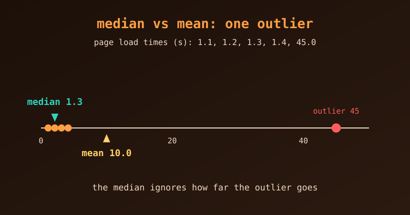

{fig-alt="Page load times on a number line: four values near 1 second and one outlier at 45 seconds. The median is 1.3 seconds and the mean is 10 seconds."}

The median is the best measure of center when the data is lopsided, contains extreme values, or lacks exact numerical spacing. It simply picks the middle value after sorting, so extreme numbers at either end cannot pull it off-center.

Let's go through the cases where the median outperforms the mean, each with a small example and its interpretation.

## 1. Skewed data

When most values cluster on one side and a few stretch into a long tail, the mean is dragged toward the tail. The median stays in the bulk of the data.

**Example:** prices (in thousands of dollars) of five homes sold in a neighbourhood:

```default
250, 290, 310, 350, 4000
```

**Interpretation:** the median is 310, meaning half the homes sold for less and half for more. This is what a typical buyer pays. The mean is 1040, inflated by the single $4 million mansion, and no home in the list is anywhere near that price. The same applies to household income.

## 2. Severe outliers

Outliers come from rare events or measurement errors. One of them can ruin the mean, while the median barely moves.

**Example:** page load times in seconds for five visitors, one on a terrible connection:

```default
1.1, 1.2, 1.3, 1.4, 45.0
```

**Interpretation:** the median is 1.3 seconds, which matches the normal user experience. The mean is 10.0 seconds, wrongly suggesting the site is slow for everyone.

## 3. Ordinal data (ranked categories)

Ordinal data has a clear order, but the distance between categories is unknown or unequal. Words cannot be added or divided, so the mean cannot be computed.

**Example:** satisfaction ratings from five customers:

```default
Poor, Fair, Good, Good, Excellent
```

**Interpretation:** after sorting, "Good" sits in the middle. We can say the typical customer rated the service "Good" without assigning arbitrary numbers to the words.

## 4. Censored or open-ended data

Sometimes extreme values are grouped into brackets such as "100+" or "Under 18", or observations are cut off by the end of a study. Without the exact end values, the true mean cannot be calculated.

**Example:** survival in a 5-year medical trial where 60% of patients are still alive at the end, recorded only as "5+ years".

**Interpretation:** we do not know how long those patients will live, but more than half of them passed 5 years, so the median survival time is greater than 5 years.

## 5. Skewed count data

Real-world counts often pile up at zero with a few big spikes.

**Example:** emergency room visits in a year for seven people:

```default
0, 0, 0, 0, 1, 2, 14
```

**Interpretation:** the median is 0, so the typical person never visits the ER. The mean is about 2.4 visits, a figure that matches almost nobody in the group.

## 6. Time-to-event data

Waiting times, delivery durations and task times have a hard floor at zero but no upper limit, which creates a natural right skew.

**Example:** support ticket resolution times in hours, where one complex bug took two days:

```default
1, 2, 2, 3, 4, 48
```

**Interpretation:** with six values the median is the average of the middle two, (2 + 3) / 2 = 2.5 hours, a realistic expectation for customers. The mean is 10 hours, which overstates the typical delay.

## Quick summary: mean vs median

| Scenario | Best choice | Why |
|:---------|:-----------:|:----|
| Symmetric data without outliers (e.g. adult heights) | Mean | Uses every value for maximum precision |
| Skewed data or extreme outliers (e.g. salaries, home prices) | Median | Ignores the tails and reflects the middle of the crowd |
| Ranked labels or open-ended brackets (e.g. survey ratings, "65+") | Median | Needs only order, not exact numbers at the extremes |

::: {.callout-tip}
Reporting both is often wise. A large gap between the mean and the median is itself a sign of skewness or outliers.
:::
