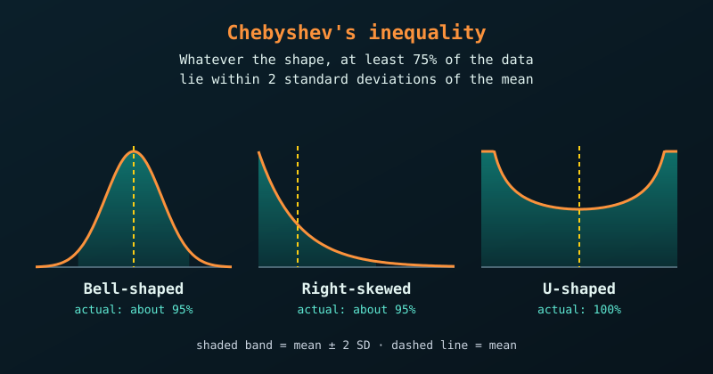

{fig-alt="Three distributions side by side: bell-shaped, right-skewed and U-shaped. A shaded band covers the mean plus and minus two standard deviations in each, and at least 75% of the data lie inside it."}

Chebyshev's inequality is great because it guarantees a minimum percentage of data within a certain number of standard deviations from the mean, **regardless of the distribution's shape**. We do not need to assume the data follow a Normal bell curve, which makes it a universal safety net for unknown, skewed, or U-shaped datasets.

## The Core Formula

For any distribution with a finite mean ($\mu$) and finite standard deviation ($\sigma$), the proportion of data within $k$ standard deviations of the mean ($k > 1$) is at least

$$
1-\frac{1}{k^{2}}
$$

- Within 2 standard deviations ($k = 2$): at least $1 - \frac{1}{2^2} = 75\%$ of the data.
- Within 3 standard deviations ($k = 3$): at least $1 - \frac{1}{3^2} \approx 88.9\%$ of the data.

## Example 1: Heavy-Tailed Data (Household Income)

Income data are skewed to the right because a few very high earners pull the tail far out, so a Normal distribution fits poorly.

Suppose a city reports a mean household income of $\mu = \$60{,}000$ with a standard deviation of $\sigma = \$15{,}000$. What is the minimum percentage of households earning between \$30,000 and \$90,000?

1. **Find $k$.** Both boundaries are \$30,000 from the mean. Dividing by the standard deviation gives $k = 30{,}000 / 15{,}000 = 2$.
2. **Apply Chebyshev.** $1 - \frac{1}{2^2} = 1 - 0.25 = 0.75$.

Without seeing a single tax return, or knowing the shape of the income gap, we can guarantee that **at least 75%** of households earn between \$30,000 and \$90,000.

## Example 2: Server Latency and SLA Guarantees

Software response times often follow irregular patterns with random spikes, yet companies must still sign strict Service Level Agreements (SLAs).

Suppose an API has a mean response time of $\mu = 100$ ms and a standard deviation of $\sigma = 20$ ms. A client asks for the worst-case share of requests that take 160 ms or longer (or 40 ms or less).

1. **Find $k$.** 160 ms is 60 ms from the mean, and $60 / 20$ gives $k = 3$.
2. **Apply Chebyshev.** At least $1 - \frac{1}{3^2} \approx 88.9\%$ of requests fall between 40 ms and 160 ms. Conversely, **at most 11.1%** fall outside this range.

Even if network traffic is erratic, the engineers can promise that no more than 11.1% of requests will breach the 160 ms limit (the bound counts both tails, so it is conservative for the slow side alone).

## Chebyshev vs. the Normal Distribution

| Distance from mean ($k$) | Normal distribution (bell curve only) | Chebyshev (any distribution) |
|:--:|--:|:--:|
| 1.5 | 86.6% | at least 55.6% |
| 2 | 95.4% | at least 75.0% |
| 3 | 99.7% | at least 88.9% |
| 4 | 99.99% | at least 93.8% |

::: {.callout-note}
Chebyshev gives a very conservative lower bound. If we know the data are Normal, the Normal distribution gives much tighter estimates.
:::

## Testing It in R

Let's test the inequality on three very different shapes: a Normal bell curve, a heavily right-skewed Exponential, and a polarised U-shaped Beta (see the [U-shaped distribution](u-shaped-probability-distribution.qmd) post). For each, we compute the exact share of data within $k = 2$ standard deviations of the mean. All three should stay above Chebyshev's 75% minimum.

```{r}
set.seed(123)
n <- 100000

# Three completely different distribution shapes
data_normal <- rnorm(n, mean = 50, sd = 10)          # bell-shaped
data_skewed <- rexp(n, rate = 0.1)                   # heavily right-skewed
data_ushape <- rbeta(n, shape1 = 0.5, shape2 = 0.5)  # U-shaped

# Actual % of data within k standard deviations of the mean
check_chebyshev <- function(data, k = 2) {
  mu <- mean(data)
  sigma <- sd(data)
  actual_prop <- mean(data >= mu - k * sigma & data <= mu + k * sigma)
  round(actual_prop * 100, 2)
}

cat("Chebyshev minimum guarantee (k = 2): 75.00%\n")
cat("Normal distribution actual:        ", check_chebyshev(data_normal), "%\n")
cat("Right-skewed (Exponential) actual: ", check_chebyshev(data_skewed), "%\n")
cat("U-shaped (Beta) actual:            ", check_chebyshev(data_ushape), "%\n")
```

All three comfortably exceed 75%. The bound is a floor valid for every distribution, not a typical value, so real data usually sit well above it.

## Visualizing the Bounds

Here are the $k = 2$ boundaries drawn over the skewed data.

```{r}
#| fig-alt: "Histogram of right-skewed data with a blue line at the mean and red dashed lines two standard deviations either side."
library(ggplot2)

mu_skew <- mean(data_skewed)
sd_skew <- sd(data_skewed)

ggplot(data.frame(x = data_skewed), aes(x)) +
  geom_histogram(bins = 60, fill = "steelblue", colour = "white") +
  geom_vline(xintercept = mu_skew, colour = "blue", linewidth = 1) +
  geom_vline(xintercept = mu_skew + c(-2, 2) * sd_skew,
             colour = "red", linewidth = 1, linetype = "dashed") +
  coord_cartesian(xlim = c(0, 60)) +
  labs(title = "Chebyshev Bounds (k = 2) on Skewed Data",
       subtitle = "Blue: mean. Red dashed: mean ± 2 SD (about 95% of the data lie inside here)",
       x = "Value", y = "Count")
```

The lower boundary falls below zero, so only the upper line is visible, yet the guarantee still holds.
