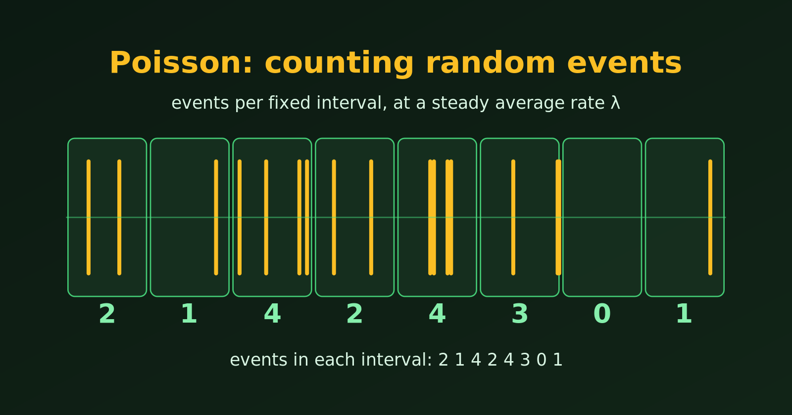

{.bk-adapt fig-alt="A timeline cut into eight equal intervals with random events shown as amber ticks and the count for each interval written below: 2, 1, 4, 2, 4, 3, 0 and 1."}

Many real situations ask the same question: **how many times will something happen in a fixed stretch of time or space?** How many requests hit a server this second? How many accidents happen at a junction this month? How many customers walk in this hour? The **Poisson distribution** is the standard model for such counts. Let's see where it is used, and then why it fits.

## Where the Poisson Distribution Is Used

The recipe is always the same: events happen at random, at a steady average rate $\lambda$, and we count them in a fixed interval. The probability of seeing exactly $x$ events is

$$
P(X = x) = \frac{e^{-\lambda} \lambda^x}{x!}, \qquad x = 0, 1, 2, \dots
$$

| Field | What we count | Interval |
|---|---|---|
| Web and IT | requests to a server, failed logins | per second, per minute |
| Customer service | calls to a call centre, customers at a till | per hour |
| Health | patients arriving at an emergency department | per hour, per night |
| Insurance and safety | accidents, claims, machine breakdowns | per month, per year |
| Quality control | defects in a roll of fabric, typos in a book | per metre, per page |
| Science | radioactive decays, stars in a patch of sky | per second, per area |
| Ecology | plants or animals in a quadrat | per square metre |
| Sport | goals in a football match | per match |

Let's look at three of these in detail, with R.

### 1. Website traffic: planning server capacity

**Scenario.** A server receives on average $\lambda = 12$ requests per second. Engineers must decide how many requests it should handle per second. How often would a capacity of 20 requests per second be exceeded?

```{r}
library(tidyverse)

lambda <- 12
traffic <- tibble(requests = 0:30, prob = dpois(requests, lambda)) %>%
  mutate(overload = requests > 20)

# probability of more than 20 requests in one second
ppois(20, lambda, lower.tail = FALSE)
```

```{r}
#| fig-width: 7
#| fig-height: 4
ggplot(traffic, aes(requests, prob, fill = overload)) +
  geom_col() +
  scale_fill_manual(values = c("FALSE" = "steelblue", "TRUE" = "tomato"),
                    labels = c("Within capacity", "Overload (above 20)")) +
  labs(title = "Requests per second, Poisson(12)",
       x = "Requests in one second", y = "Probability", fill = NULL)
```

An overload is rare in any one second, but a server handles thousands of seconds a day, so even a small probability matters. The Poisson model lets us compute it from the average rate alone.

### 2. Accidents: pricing risk

**Scenario.** A junction averages $\lambda = 3.5$ accidents per month. An insurer wants the probability of a month with no accidents, and of a very bad month with 8 or more.

```{r}
lambda <- 3.5

# exact probabilities
c(no_accident = dpois(0, lambda),
  eight_or_more = ppois(7, lambda, lower.tail = FALSE))
```

We can also simulate ten thousand months and check that the simulation agrees with the formula.

```{r}
#| fig-width: 7
#| fig-height: 4
set.seed(42)
months <- tibble(accidents = rpois(10000, lambda))

mean(months$accidents == 0)   # simulated share of clean months

months %>%
  count(accidents) %>%
  mutate(simulated = n / sum(n), exact = dpois(accidents, lambda)) %>%
  ggplot(aes(accidents)) +
  geom_col(aes(y = simulated), fill = "firebrick", alpha = 0.7) +
  geom_point(aes(y = exact), size = 2) +
  scale_x_continuous(breaks = 0:12) +
  labs(title = "10,000 simulated months (bars) and the exact Poisson(3.5) (points)",
       x = "Accidents in a month", y = "Proportion of months")
```

### 3. Wildlife: are the plants scattered at random?

The Poisson distribution works in space as well as in time. Suppose we count orchids in 15 quadrats of one square metre each.

```{r}
field <- c(2, 1, 0, 3, 2, 1, 4, 1, 0, 2, 1, 2, 3, 0, 1)   # orchids per quadrat

mean(field)
var(field)

# observed counts against the counts expected from a Poisson with the same mean
tibble(orchids = 0:4) %>%
  mutate(observed = map_int(orchids, ~ sum(field == .x)),
         expected = round(length(field) * dpois(orchids, mean(field)), 1))
```

If the plants are scattered completely at random, the counts per quadrat follow a Poisson distribution, so the variance is close to the mean. If they cluster, the variance is much larger than the mean. Here the two are close, and the observed counts are near the expected ones, so these orchids look randomly scattered. (With only 15 quadrats this is a rough check, not a proof.)

## Why It Fits: The Conditions and Features

The Poisson distribution is a good model when:

1. **Events are independent.** One event happening does not change the chance of the next. A call arriving does not make another call more or less likely.
2. **The average rate is steady.** The rate $\lambda$ is the same across the interval. A call centre with a lunchtime rush does not have a constant rate over the whole day, so we model shorter periods separately.
3. **Events occur one at a time.** Two events almost never happen at exactly the same instant.
4. **We only count events.** There is no fixed number of trials. Unlike the binomial distribution, we do not need to know a maximum $n$, and the count can in principle be any whole number.

What follows from these conditions:

- **One parameter.** The average rate $\lambda$ is all we need to know.
- **The mean equals the variance.** Both are $\lambda$. This gives a quick check on real data: if the variance is much larger than the mean, the Poisson model is a poor fit (the counts are "overdispersed", often because events cluster).
- **Skewed for small $\lambda$, bell-shaped for large $\lambda$.** See [the normal approximation](poisson-to-normal-distribution.html).
- **Close to the binomial for rare events.** See [when a binomial can be approximated by a Poisson](binomial-approximated-by-poisson.html).

::: {.callout-note}
The "memoryless" property that is sometimes mentioned belongs to the **waiting time** between events, which follows the exponential distribution, and not to the Poisson count itself. If events occur as a Poisson process, the wait until the next event does not depend on how long we have already waited.
:::

## Checking the Mean and Variance in R

Here is the check in practice. For real Poisson data the variance is close to the mean, and for clustered data it is not.

```{r}
set.seed(1)
poisson_data   <- rpois(1000, 4)
clustered_data <- rnbinom(1000, mu = 4, size = 1)   # events that cluster

c(mean = mean(poisson_data),   variance = var(poisson_data))
c(mean = mean(clustered_data), variance = var(clustered_data))
```

The first pair is close, which supports a Poisson model. The second has a variance several times the mean, so a Poisson model would underestimate how variable the counts are.

## Summary

- The Poisson distribution models **counts of random events** in a fixed time or space, at a steady average rate.
- It appears in IT traffic, call centres, hospitals, insurance, quality control, science and ecology.
- It needs only one parameter, $\lambda$, which is both the mean and the variance.
- It fits when events are independent and the rate is steady. If the variance is far above the mean, look for another model.

Related: for large $\lambda$ the Poisson looks like a normal curve, see [Normal Approximation to the Poisson Distribution](poisson-to-normal-distribution.html).
