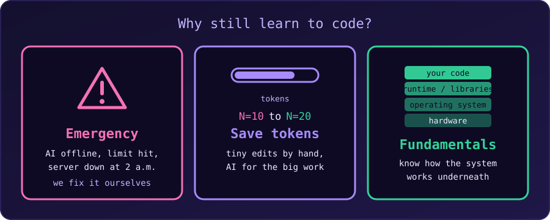

{fig-alt="Three cards: Emergency (AI offline or a server down at night), Save tokens (tiny edits by hand, AI for the big work), and Fundamentals (a stack from our code down to the hardware)."}

Learning a programming language in the age of AI is still worth it, but **the reason has shifted**.

In the past, learning to code was mostly about memorising syntax and making a computer do one specific task. Today, AI can write basic code, fix bugs and generate whole scripts in seconds. That does not make programmers obsolete; it makes the ones who understand the code **more powerful**. Here is why a computer language is still worth learning.

## 1. We Must Direct the AI

AI is a tool, and a tool needs a skilled operator. To get good code from an AI, we have to describe the problem precisely. Without programming logic, data structures and some feel for how systems work, we won't know how to break a big problem into smaller tasks, what to ask for, or when the answer is wrong or insecure.

We cannot manage an AI well if we don't know the language it is speaking.

## 2. We Should Know How the System Works

Code runs on something: memory, a file system, processes, a network, a compiler or interpreter. AI-written code sits on top of all of it, and the bugs often come from underneath. For example, in C:

- an AI-written function returns a pointer to a local variable. It compiles, and it may even seem to work, until it doesn't;
- a loop reads one element past the end of an array;
- a program is "fast on my laptop" but slow on the server because of how it uses memory or disk.

If we don't know about the stack, the heap, integer overflow or how a request travels over a network, we cannot see these problems in generated code, and we cannot even ask the right question about them. The fundamentals are the questions we know to ask, and the way we judge the answers.

## 3. The "Last Mile": Integration and Debugging

AI can produce a block of code, but a complete application has to fit into the systems around it.

- **Integration:** connecting the code to our databases, servers and user interfaces.
- **Debugging:** when the code breaks (and it will), someone has to trace the error, read the logs and fix the logic. AI sometimes writes code that looks right but fails on edge cases, and a person who can code is needed to catch it.

## 4. Emergencies Don't Wait for the AI

Sooner or later there is an emergency: a server is down at 2 a.m., a script has to run correctly before a deadline in an hour, or a bug is losing data right now. In that moment:

- the AI service may be unavailable, or our usage limit may be used up;
- we may be offline, or working on a private machine where we can't paste code and logs into a chat;
- the AI doesn't know our whole system and can't see what we can see.

That is not the time to start learning the basics. In an emergency we need to read the code, find the fault and make the fix ourselves, calmly and quickly. Think of it as a fire drill: we practise before we need it.

## 5. Save the Tokens for the Big Work

AI usage costs tokens, time and sometimes money, and most plans have limits. A tiny edit is often faster to do by hand than to describe:

| Do it by hand | Ask the AI |
| :--- | :--- |
| change `#define N 10` to `#define N 20` | write a new module or a test suite |
| rename a variable, fix a typo | explain an unfamiliar codebase |
| fix an off-by-one in a loop bound | translate code between languages |
| change a format string | design and compare several approaches |
| move a line up or down | find the cause of a bug we can't locate |

Typing a one-line change takes seconds. Writing a prompt, waiting, reading the answer and checking that the AI did not also "improve" five other lines takes longer, and spends tokens we may want later for the work that really needs them. If we can code, we can keep the AI for the heavy lifting.

## 6. Computational Thinking and Problem Solving

Learning a language is not just typing syntax. It teaches **computational thinking**: breaking a complex, vague problem into logical, step-by-step parts. That skill is useful in any career, and especially when we manage AI projects. AI is good at solving *defined* problems, while people are still better at *defining* them in the first place.

## 7. Security, Privacy and Ethics

AI generates code, but we are still responsible for the final product. Copying AI code blindly can introduce vulnerabilities such as SQL injection or leaked data. Understanding the code is the only way to audit it, protect users' data and make sure the program does what it should.

## 8. Someone Builds and Oversees the AI

AI models don't build themselves. Their progress needs people who understand mathematics, logic and programming languages (such as Python, C++ and R) to:

- build the infrastructure that runs the models,
- fine-tune the algorithms,
- manage the data pipelines,
- keep the systems secure and ethical.

As AI takes over basic coding tasks, the value moves toward **architects and system designers**: people who can oversee the AI, combine several tools, and design the overall system.

## Summary

In the AI age, learning to code is no longer just about being a translator for the computer. It is about becoming the **conductor of an orchestra**: AI provides the instruments, and someone who understands the language of code makes them play in harmony. And when the orchestra stops, as in an emergency, it is that person who has to keep playing.

If we are learning to code today, the practical advice is:

1. Learn the **fundamentals** (one language well, plus how memory, files and networks work), not just syntax.
2. Write and fix the **small things by hand**, so the skill stays sharp and the tokens last.
3. Use AI for the **big, repetitive or exploratory** work, and always read and test what it gives us.
4. Practise the **emergency**: now and then, solve a problem with the AI switched off.
