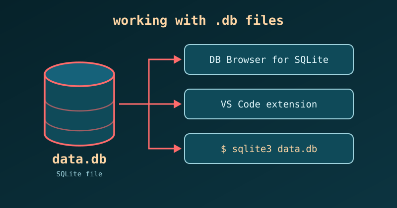

{fig-alt="A database cylinder labelled data.db with arrows to three tools: DB Browser for SQLite, a VS Code extension and the sqlite3 terminal command."}

Most `.db` files are **SQLite** databases, so the easiest way to open one is with a dedicated viewer such as DB Browser for SQLite. But `.db` is a generic extension used by many programs, so the right method depends on what created the file.

## First, check what the file is

On Linux and macOS, the `file` command tells us whether it is SQLite:

```bash
file yourfile.db
```

```default
yourfile.db: SQLite 3.x database, last written using SQLite version 3037002, ...
```

If it says `SQLite 3.x database`, everything below applies. If not (a Paradox database or an application cache, for example), open it with the program that created it.

::: {.callout-warning}
Make a copy of the file before editing it. SQL commands such as `UPDATE` and `DELETE` change the data for good once saved.
:::

## Ways to open a .db file

### 1. DB Browser for SQLite (desktop)

[DB Browser for SQLite](https://sqlitebrowser.org/) is free for Windows, macOS and Linux. Click **Open Database** and pick the file. We can then browse tables, run SQL queries and edit records.

### 2. A browser-based viewer

Local, browser-based SQLite viewers are quick for read-only inspection. Check that the tool runs the file in our browser and does not upload it to a server, especially for private data.

### 3. Visual Studio Code

Install an SQLite extension from the Extensions marketplace. Then press `Ctrl+Shift+P` (`Cmd+Shift+P` on macOS), run **SQLite: Open Database**, and choose the file. The tables appear in the **SQLite Explorer** sidebar.

### 4. The command line

```bash
sqlite3 yourfile.db
```

Inside the `sqlite3` prompt, two commands help us look around:

```default
.tables
.schema
```

`.tables` lists the tables and `.schema` shows how they were created. Type `.quit` to leave.

## Editing data and running SQL

Let's say the file has a table `users` created like this:

```sql
CREATE TABLE users (id INTEGER PRIMARY KEY, name TEXT, active INTEGER);
```

with three rows:

| id | name   | active |
|:--:|:-------|:------:|
| 1  | Asha   | 0      |
| 2  | Ben    | 1      |
| 3  | Chitra | 0      |

### In DB Browser for SQLite (recommended)

1. **Open** the file with **Open Database**.
2. **Edit visually.** On the **Browse Data** tab, choose the table from the dropdown, double-click any cell to change it, or use **New Record** and **Delete Record**.
3. **Run SQL.** On the **Execute SQL** tab, type a statement and press the play button (or `F5` / `Ctrl+Enter`):

   ```sql
   UPDATE users SET active = 1 WHERE id = 1;
   SELECT * FROM users WHERE active = 1;
   ```

   The `SELECT` now returns Asha and Ben:

   | id | name | active |
   |:--:|:-----|:------:|
   | 1  | Asha | 1      |
   | 2  | Ben  | 1      |

4. **Save.** Click **Write Changes**. Until we do, the edits are not stored in the file.

### In VS Code

Right-click a table in the **SQLite Explorer** sidebar and choose **New Query**. A query editor opens, and we can write and run SQL against the database directly.

### In the sqlite3 command line

Type SQL statements ending with a semicolon:

```sql
SELECT * FROM users;
INSERT INTO users (name, active) VALUES ('Dev', 1);
```

Changes made with SQL commands in `sqlite3` are saved automatically when each statement finishes.

## Exporting a table to CSV

To open a table in a spreadsheet, export it from `sqlite3`:

```default
.headers on
.mode csv
.output users.csv
SELECT * FROM users;
.output stdout
```

The last line sends output back to the screen. The file `users.csv` can now be opened in any spreadsheet program.

## Key takeaway

- Check the file type first: `file yourfile.db`.
- For clicking and editing, use DB Browser for SQLite; for scripting, use `sqlite3`.
- Keep a backup, and remember **Write Changes** in DB Browser.

## References

- [DB Browser for SQLite](https://sqlitebrowser.org/)
- [Command Line Shell For SQLite](https://sqlite.org/cli.html)
