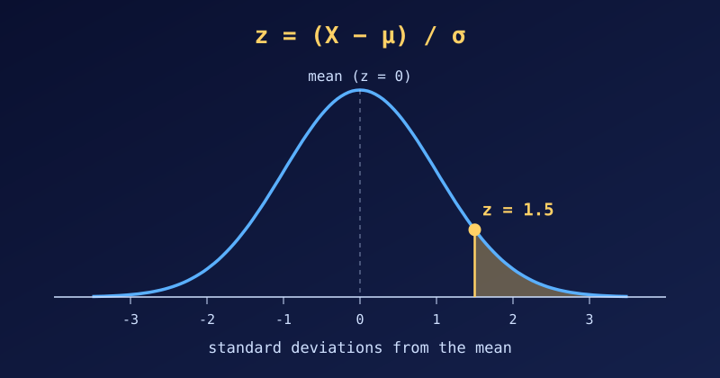

{fig-alt="A bell curve with a z-axis from -3 to 3. A point at z = 1.5 is marked and the tail beyond it is shaded."}

A **z-score** (also known as a **standard score** or **z-value**) measures how many standard deviations a data point is from the mean of a distribution. It's a way of standardizing individual data points so they can be compared, regardless of the scale of the data.

### How to calculate the z-score:

The formula for the **z-score** of a data point is:

$z = \frac{X - \mu}{\sigma}$

Where:

* $X$ = the value of the data point.
* $\mu$ = the mean (average) of the dataset.
* $\sigma$ = the standard deviation of the dataset.

### Steps to calculate the z-score:

1. **Find the mean** of the dataset.
2. **Find the standard deviation** of the dataset.
3. **Subtract the mean** from the data point you're interested in.
4. **Divide the result** by the standard deviation.

### Example:

Imagine you have the following dataset of test scores: [80, 85, 90, 95, 100]

* **Mean (μ)**: (80 + 85 + 90 + 95 + 100) / 5 = 90
* **Standard Deviation (σ)**: the sample standard deviation is $\sqrt{250/4} \approx$ **7.91**.
* To find the **z-score** for a score of **85**:

  $z = \frac{85 - 90}{7.91} \approx -0.63$

  This means the score of 85 is **0.63 standard deviations below the mean**.

---

---

### How to interpret a z-score

The **sign** tells the direction (above or below the mean) and the **size** tells the distance in standard deviations.

| z-score | Meaning |
|:-------:|:--------|
| 0 | exactly at the mean |
| +1 | one standard deviation above the mean |
| −2 | two standard deviations below the mean |
| beyond ±3 | very unusual; a possible outlier |

**Example: comparing two exams.** Sara scores 85 in Math and 78 in English. Which is the better result?

| Subject | Score ($X$) | Class mean ($\mu$) | Std. dev. ($\sigma$) | z-score |
|:-------:|:-----------:|:-------------------:|:--------------------:|:-------:|
| Math    | 85          | 70                  | 10                   | 1.5     |
| English | 78          | 70                  | 4                    | 2.0     |

$$
z_{\text{Math}} = \frac{85 - 70}{10} = 1.5, \qquad z_{\text{English}} = \frac{78 - 70}{4} = 2
$$

Math has the higher raw score, but English is the stronger result: it is 2 standard deviations above the class mean, against 1.5 for Math.

If scores are roughly normal, a z-score also converts to a percentile. A z of 1.5 means Sara beat about 93% of the class in Math; a z of 2 means about 98% in English.

---

### When a z-score is suitable

* The data is **roughly normal** (bell-shaped), so the percentile reading above is reliable.
* The variable is **numerical on an interval or ratio scale** (scores, heights, weights, prices).
* You want to **compare values measured on different scales** or in different groups.
* You want to **flag outliers** with a quick rule such as $|z| > 3$.
* The **sample is reasonably large**, so the mean and standard deviation are stable estimates.

### When a z-score is not suitable

* **Heavily skewed data** (income, house prices, waiting times): a z of 2 no longer means "top 2.5%", and the mean and standard deviation are themselves pulled by the tail.
* **Data with extreme outliers**: they inflate both $\mu$ and $\sigma$, so the outlier hides its own large z-score. A robust version uses the median and MAD.
* **Categorical or ordinal data** (colours, "Poor/Good/Excellent"): there is no meaningful mean or standard deviation.
* **Very small samples**: the estimated mean and standard deviation are unreliable, so the z-score is shaky.
* **Bounded or discrete data with a skewed shape** (counts piled up at zero, proportions near 0 or 1): the normal reading of percentiles breaks down.

::: {.callout-note}
A z-score is always computable, but the percentile interpretation holds only for roughly normal data. For other shapes, Chebyshev's inequality still guarantees at least 75% of values within |z| < 2.
:::

---

### Common uses of the z-score:

1. **Standardizing data**:
   Z-scores are used to standardize data, especially when you want to compare values from different datasets with different units or scales.

2. **Identifying outliers**:
   A data point with a z-score greater than +3 or less than -3 is often considered an **outlier** because it lies more than 3 standard deviations away from the mean.

3. **Probability and normal distribution**:
   In statistics, z-scores are crucial when working with the **normal distribution**. They can be used to find the **probability** of a value occurring within a normal distribution by looking up the z-score in a standard normal distribution table (or using statistical software).

4. **Comparing scores across different distributions**:
   For example, in education, z-scores allow you to compare scores from different tests, even if those tests have different scales (e.g., SAT vs. ACT scores). You can convert raw scores into z-scores to compare relative performance.

5. **Risk assessment and finance**:
   In finance, z-scores can be used to assess the risk or financial stability of a company. The **Altman Z-score**, for instance, is used to predict the likelihood of bankruptcy.

6. **Quality control and manufacturing**:
   In quality control, z-scores help assess whether a product meets specifications, identifying whether the production process is consistent or if corrective action is needed.
