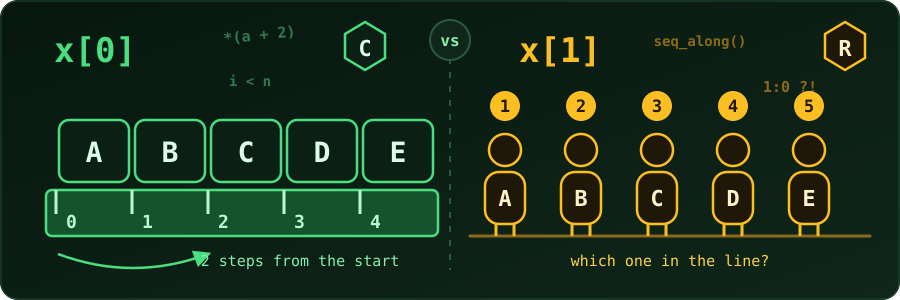

{fig-alt="Left, letters A to E stand on a ruler marked 0 to 4 beside x[0], showing the index as distance from the start. Right, five people in a queue wear badges 1 to 5 beside x[1], showing the index as position in the line."}

Every beginner trips on it once. In C and Python the first element of a list is `x[0]`. In R it is `x[1]`. Neither side is being silly: they answer two slightly different questions. Let's see what those questions are.

## Two questions, two numbers

When we say "the third item", we can mean either of these:

- **Position:** *which one in the line is it?* Counting from one, it is number 3.
- **Offset:** *how far is it from the start?* Two steps away.

Zero-based indexing stores the **offset**. One-based indexing stores the **position**. The first item is zero steps from the start, but it is also the first one in the line. Both statements are true, and that is the whole disagreement.

## Everyday analogies

### Zero-based: things that measure distance

- **A ruler.** The scale starts at 0 cm, not 1 cm. The first centimetre box lies *between* 0 and 1. A mark's label tells us how far it is from the edge.
- **Age.** A newborn is 0 years old. At "age 1" a full year has already gone by.
- **A clock.** Minutes run from 00 to 59 and the hour restarts at 0. Nobody writes 60 minutes past; it rolls over to 0.
- **Floors in many countries.** The ground floor is floor 0, and the first floor is one flight of stairs up. The number counts the stairs we climbed.
- **Mile markers.** The marker at the start of a highway says 0. A marker reading 5 means 5 miles travelled.

An array works the same way. The computer keeps the address where the array begins, and `x[i]` means "start there, then move `i` slots forward."

### One-based: things that count members

- **A queue.** The person at the front is the 1st person. Nobody says "person number zero."
- **Book pages and chapters.** Chapter 1 is the first chapter.
- **Spreadsheet rows.** Row 1 is the top row, and column 1 is column A.
- **Seat numbers, rank in a race, house numbers.** All of them start at 1 because they label *members of a set*.

A statistician talks like this naturally: the observations are $x_1, x_2, \dots, x_n$, and $x_n$ is the last of $n$ values. That habit is the reason R looks the way it does.

## Why programming languages chose zero

### 1. The index really is an offset

In C, an array name is the address of its first element, and `a[i]` is defined as `*(a + i)`: go `i` elements past the start, then read. For the first element we move nowhere, so the index must be 0. Let's check this with real addresses.

```c
#include <stdio.h>

int main(void) {
    int a[4] = {10, 20, 30, 40};
    for (int i = 0; i < 4; i++)
        printf("a[%d] = %d   address = %p   offset = %td bytes\n",
               i, a[i], (void *)&a[i], (char *)&a[i] - (char *)&a[0]);
    printf("*(a + 2) = %d\n", *(a + 2));
    return 0;
}
```

```
a[0] = 10   address = 0x7fff874b6ca0   offset = 0 bytes
a[1] = 20   address = 0x7fff874b6ca4   offset = 4 bytes
a[2] = 30   address = 0x7fff874b6ca8   offset = 8 bytes
a[3] = 40   address = 0x7fff874b6cac   offset = 12 bytes
*(a + 2) = 30
```

(The addresses change from run to run; the offsets do not.) Each `int` takes 4 bytes, so element `i` sits `4 * i` bytes from the start. With zero-based indexing the address is just `start + i * size`. With one-based indexing the compiler would have to compute `start + (i - 1) * size`, an extra subtraction hidden in every access. Early machines were slow and small, so C's ancestors (BCPL, and then C itself) kept the index equal to the offset and avoided that cost.

### 2. Half-open ranges are tidy

The computer scientist Edsger Dijkstra made a famous argument in a 1982 note, *Why numbering should start at zero*. To describe a run of elements, the neatest convention is "from `a`, up to but **not including** `b`". Then:

- the number of elements is simply `b - a`;
- two neighbouring ranges share a boundary: `[0, 3)` and `[3, 5)` join with no gap and no overlap;
- the whole array of `n` elements is `[0, n)`, which needs no `+ 1` or `- 1`.

Python slicing follows this rule:

```python
x = [10, 20, 30, 40, 50]
print(x[0], x[-1])         # first and last
print(x[1:3])              # elements 1 and 2, stop *before* 3
print(x[:2] + x[2:])       # split anywhere, glue back together
print(len(x[1:4]))         # 4 - 1
```

```
10 50
[20, 30]
[10, 20, 30, 40, 50]
3
```

Think of fence posts. A slice `x[1:3]` is described by the *posts* (the boundaries at 1 and 3), and the length is the gap between them, 3 - 1 = 2 panels. Zero-based indices label the posts, which is why the arithmetic is clean.

### 3. Loops and wrap-around are neat

Looping over `n` items is `for (i = 0; i < n; i++)`. Cycling through them is `i % n`, which gives exactly `0, 1, ..., n-1` and then restarts. A clock face, a circular buffer, a hash table bucket and a pixel in a row of an image are all handled by `%` with no adjustment. With one-based numbering, wrap-around needs `(i - 1) % n + 1`.

## Why R starts at one

R did not appear from nowhere. It is a free implementation of the **S** language, designed at Bell Labs for data analysis. Its design was driven by what statisticians and mathematicians already write on paper, and not by how memory is laid out.

- **Mathematical notation.** Vectors are $x_1, \dots, x_n$ and matrices have entries $a_{ij}$ with $i$ from 1 to the number of rows. R code can look the same as the formula in a textbook.
- **Heritage.** S borrowed from Fortran-style numerical computing, which counts from one. MATLAB, Julia, Lua and Fortran are one-based too.
- **Vectors, not addresses.** R users rarely think about memory. A vector is "a list of values", and the first value is the first value.
- **Length equals last index.** In R, `x[length(x)]` is the last element, and `x[n]` is the *n*th element. The words and the numbers agree.

```r
x <- c(10, 20, 30, 40, 50)
x[1]               # first element
x[length(x)]       # last element
x[2:4]             # elements 2, 3 and 4: both ends included
m <- matrix(1:6, nrow = 2)
m[2, 3]            # row 2, column 3
```

```
[1] 10
[1] 50
[1] 20 30 40
[1] 6
```

Notice that R ranges are **closed**: `2:4` includes both 2 and 4, so "elements 2 to 4" means what it says. That is natural for human counting, even though it loses Dijkstra's tidy arithmetic.

## Careful: where each convention bites

Both conventions have a famous trap.

**R: index 0 is not an error, it is silently empty.** And a negative index means *drop*, not "count from the end":

```r
x <- c(10, 20, 30, 40, 50)
x[0]      # numeric(0): an empty result, no warning
x[-1]     # everything except the first element
x[6]      # NA: out of range, still no error
```

```
numeric(0)
[1] 20 30 40 50
[1] NA
```

In Python `x[-1]` is the *last* element, and `x[5]` on a five-element list raises an `IndexError`. The same-looking code means different things.

**R: `1:length(y)` is dangerous for empty vectors.** If `y` is empty, `1:0` is the sequence `1, 0`, so a loop runs twice, with nonsense indices:

```r
y <- integer(0)
1:length(y)       # counts down!
seq_along(y)      # safe: gives nothing
```

```
[1] 1 0
integer(0)
```

Use `seq_along(y)` in loops. It is also the idiomatic R way to say "for each index".

**C and Python: the off-by-one error.** Because the last valid index is `n - 1`, writing `i <= n` instead of `i < n` reads one element past the end. In C that is undefined behaviour and no error is raised: the program may crash, print garbage, or seem to work. This family of bugs is so common it has a name, the *off-by-one error* or fencepost error.

## Advantages and disadvantages

| | **Zero-based** (C, Python, Java, JavaScript) | **One-based** (R, Fortran, MATLAB, Julia) |
|---|---|---|
| **Meaning of the index** | Offset from the start | Position in the line |
| **Machine cost** | Address is `start + i * size`, no adjustment | Needs `i - 1` (compilers hide it, but it is there) |
| **Ranges** | Half-open `[a, b)`: length is `b - a`, neighbours join cleanly | Closed `a:b`: matches how we speak, length is `b - a + 1` |
| **Wrap-around (`%`)** | Direct: `i % n` | Needs `(i - 1) %% n + 1` |
| **Last element** | `x[n - 1]` (or `x[-1]` in Python) | `x[n]`, matches "the *n*th item" |
| **Maths and statistics** | Formulas need translating ($x_1$ becomes `x[0]`) | Code mirrors the formula |
| **Beginner friendliness** | "Why is the first one 0?" is a hurdle | Matches everyday counting |
| **Typical bug** | Off-by-one at the end of loops | Off-by-one when porting zero-based code; `1:0` loops |
| **Typical strength** | Low-level control, array arithmetic, slicing | Readable data analysis |

::: {.callout-tip}
## Moving between languages

When translating code from Python to R, add 1 to every index. Going from R to Python, subtract 1. Also remember that Python's `x[a:b]` has `b - a` elements, while R's `x[a:b]` has `b - a + 1`. Write a tiny test with a 5-element vector before trusting a conversion.
:::

## So who is right?

Neither. Zero-based indexing is the right choice for a language that sits close to memory, because the index is literally a distance. One-based indexing is the right choice for a language that sits close to mathematics, because the index is literally a label. C was built to write operating systems and R was built to analyse data, so each picked the convention that suited its users.

What matters in practice is to **know which question the index answers** in the language we are using: *how far from the start?* or *which one in the line?* Once that is clear, the off-by-one mistakes become much easier to spot.

## Reference

- E. W. Dijkstra, *Why numbering should start at zero*, EWD831 (1982).
